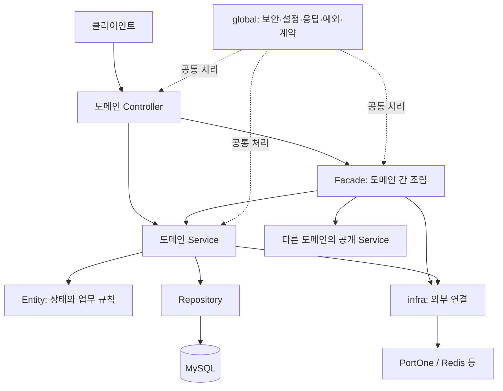

# Recipick 프로젝트 아키텍처와 계층형 구조 선택 근거

Recipick은 하나의 Spring Boot 애플리케이션 안에서 회원·상품·레시피·주문·결제를 도메인별로 나누고,
각 도메인 내부에 계층을 두는 구조를 사용합니다. 도메인별 업무 규칙은 Service와 Entity에서 관리하고,
여러 도메인을 연결하는 요청은 Facade에서 조립합니다.

이 문서는 프로젝트 전체의 구조·역할·선택 이유를 설명합니다. 아래 기능 흐름은 구조를 보여 주는 대표 예시입니다.

| 항목 | 내용 |
| --- | --- |
| 담당 | 채빈 |
| 작성·최종 확인일 | 2026-10-26 |
| 문서 상태 | 초안 수정 중, 사용자 확인 대기 |
| 코드 기준 | `dev`의 `64c379d`를 기준으로 분기한 `docs/project-documentation` |
| 관련 작업 | [문서 정리 #193](https://github.com/angel-kitchen/recipick/issues/193) |
| 확인 방법 | 실제 패키지·대표 호출 흐름·트랜잭션 선언·기존 테스트 소스 대조 |

## 1. 프로젝트의 요구와 판단 기준

서비스의 핵심 흐름은 레시피 탐색 → 재료에 맞는 상품 구성 → 장바구니 → 주문 → 결제·배송입니다.
회원·배송지·멤버십은 이 흐름에서 이용 지역과 기능·혜택의 기준을 제공하고,
관리자는 마트·상품·레시피와 주문 처리 상태를 관리합니다.

이 흐름은 담당 도메인별로 개발하지만, 하나의 요청에서 여러 도메인의 정보와 규칙을 사용합니다.
구조를 선택할 때 다음 조건을 함께 고려했습니다.

| 판단 기준 | 프로젝트에서 필요한 이유 |
| --- | --- |
| 업무별 책임과 파일 위치 | 각 담당자가 관련 코드와 정책을 한 도메인 안에서 찾고 변경할 수 있어야 함 |
| 도메인 간 협력 | 레시피가 상품 후보를 조회하고 주문 도메인의 장바구니에 담는 흐름 등을 연결해야 함 |
| 내부 데이터의 일관성 | 주문·재고·결제처럼 함께 성공하거나 실패해야 하는 변경이 있음 |
| 외부 시스템 실패 처리 | PG·Redis 등 외부 연결의 지연과 실패를 업무 상태·DB 트랜잭션과 구분해야 함 |
| 검증과 운영 부담 | 공통 실행 환경에서 기능·실제 DB·동시성을 검증하고, 초기 운영 구성을 관리할 수 있어야 함 |

## 2. 선택: 도메인별 패키지 안에 계층 분리

애플리케이션을 배포 단위로 유지하고, 소스 코드는 업무 경계와 계층 책임을 함께 표현합니다.
업무 데이터는 공통 MySQL에 저장하며 Redis와 PortOne 등의 외부 연결은 `infra`에 둡니다.

```text
com.recipick
├─ domain
│  ├─ member
│  ├─ product
│  ├─ recipe
│  ├─ order
│  └─ payment
├─ global
└─ infra
```

| 영역 | 담당 책임 | 다른 영역에 제공하는 정보·기능의 예 |
| --- | --- | --- |
| `member` | 회원·관리자·배송지·지역·멤버십 | 인증 주체, 회원 프로필·이용 마트, 이용권 확인 |
| `product` | 마트·카테고리·상품·재고·재료 연결 | 상품 후보·가격·판매 상태·판매 단위, 재고 차감·복구 |
| `recipe` | 레시피·재료·찜·자동 구성 | 선택 메뉴의 재료 필요량, 구매할 상품·수량 구성 |
| `order` | 장바구니·담기 이력·주문·마트 처리 | 담기·주문 생성, 소유권·주문 상태 확인, 주문 상태 변경 |
| `payment` | 결제·환불과 포인트·구독 결제의 업무 범위 | 결제 상태 확인·결과 반영·취소·환불 계약 |
| `global` | 보안·설정·예외·응답·공통 계약 | 인증·권한 처리, 공통 응답·오류, 감사 기록 인터페이스 |
| `infra` | 외부 통신과 접근 기술 | PortOne Client, Redis 저장소 등 |

표는 도메인의 책임 범위를 설명합니다. 포인트·구독·AI 등 개별 기능의 구현 상태는 요구사항·병합된 코드·검증 자료에서 구분합니다.

### 2-1. 계층별 역할

각 도메인에는 필요한 Controller·Facade·Service·Repository·Entity·DTO를 둡니다.

| 구성 | 책임 | 대표 판단 |
| --- | --- | --- |
| Controller | HTTP 입력 검증, 인증 주체 수신, 응답 변환 | 어떤 요청을 받고 어떤 형식으로 응답하는가 |
| Facade | 여러 도메인의 공개 기능 호출과 작업 순서·트랜잭션 경계 조립 | 어떤 업무를 어떤 순서와 경계로 연결하는가 |
| Service | 해당 도메인의 조회·검증·상태 변경을 공개 메서드로 제공 | 자기 도메인에서 허용되는 작업인가 |
| Entity | 상태와 상태 전이·수량 같은 업무 규칙 | 현재 상태에서 무엇을 바꿀 수 있는가 |
| Repository | 저장·조회·검색·잠금 쿼리 | 필요한 데이터를 어떻게 읽고 저장하는가 |
| DTO | HTTP 요청·응답과 도메인 간 전달 값 | 경계를 넘어 어떤 정보가 필요한가 |

단일 도메인에서 끝나는 처리는 Controller가 Service에 위임합니다.
다른 도메인의 정보나 변경을 함께 조립해야 할 때 Facade를 사용합니다.



그림은 대표 호출 관계를 나타냅니다. 패키지 사이의 모든 Java 의존 관계나 실제 서버 배치 구성을 뜻하지는 않습니다.

### 2-2. 도메인 경계와 공통 코드

다른 도메인의 정보·변경은 공개 Service 메서드로 요청하고, 필요한 결과는 ID·DTO 등의 계약으로 전달합니다.
복수 도메인의 조립은 Facade가 맡으며, 다른 도메인 Repository를 직접 조회하거나 수정하는 경로를 만들지 않는 것이 공통 규칙입니다.

`global`에는 여러 영역이 함께 쓰는 처리와 계약을 둡니다. 특정 도메인 저장 구현을 호출자와 분리해야 하는 경우
공통 인터페이스를 두고 담당 도메인이 구현합니다. 감사 기록의 `AdminAuditRecorder`가 이 방식의 한 예입니다.
`infra`는 통신·응답 해석·Redis 접근을 담당하며, 주문 취소 가능 여부 같은 업무 판단은 도메인에서 처리합니다.

### 2-3. 트랜잭션과 외부 호출

| 요청의 성격 | 경계 구성 | 이유 |
| --- | --- | --- |
| 읽기 전용 조회 | Service 또는 조회 Facade의 읽기 전용 트랜잭션 | 필요한 조회 결과를 조립하고 상태 변경과 구분 |
| 여러 도메인의 내부 DB 변경 | Facade의 쓰기 트랜잭션에 참여 Service가 합류 | 주문·재고·내부 결제 등 변경을 함께 커밋·롤백 |
| 외부 호출이 필요한 변경 | 내부 접수 저장·커밋 → 외부 호출 → 결과 반영 트랜잭션 | 외부 호출은 DB 롤백 대상이 아니며 DB 잠금을 잡고 응답을 기다리지 않도록 분리 |

Facade는 요청에 맞는 경계를 조립합니다. 외부 호출이 있으면 별도 컴포넌트의 짧은 트랜잭션으로 단계를 나누므로
모든 Facade 전체가 하나의 `@Transactional`로 묶이는 것은 아닙니다.
관리자 개인정보 조회처럼 감사 기록을 함께 남기는 조회는 공통 정책에 따라 쓰기 가능한 트랜잭션을 사용합니다.

잠금·UNIQUE·멱등 키와 상태 전이는 각 자원의 중복 변경을 방어합니다.
계층 분리 자체가 동시성이나 외부 결제의 정합성을 보장하는 것은 아니므로, 구체적인 규칙과 검증을 별도로 둡니다.
이벤트는 일시적인 불일치를 허용하는 후처리에 사용하는 정책이며, 같은 트랜잭션이 필요한 핵심 변경은 동기 호출로 처리합니다.

## 3. 다른 구조와 비교한 이유

아래 비교는 현재 프로젝트의 요구와 제약을 기준으로 정리한 선택 근거입니다.

| 후보 | 장점 | 현재 프로젝트에서의 비용·한계 |
| --- | --- | --- |
| 계층별 최상위 패키지 | 같은 역할의 클래스를 모아 찾기 쉬움 | 한 기능의 Controller·Service·Repository가 흩어지고 담당 업무의 경계가 덜 드러남 |
| **도메인별 패키지 + 계층형 구조(선택)** | 업무와 파일 위치가 연결되고 공유 DB 트랜잭션으로 협력 가능 | 도메인 간 공개 계약과 호출 방향을 리뷰로 관리해야 함 |
| 포트·어댑터 경계를 더 세분화 | 외부 구현 교체·도메인 격리를 명확히 표현 가능 | 인터페이스·변환 계층이 늘고 팀 전체가 같은 추상화 수준을 유지해야 함 |
| 도메인별 서비스·DB 분리 | 독립 배포·확장·장애 격리에 유리 | 분산 트랜잭션·통신 실패·상태 복구·운영 구성이 추가됨 |

현재는 도메인별 개발 책임과 내부 트랜잭션을 함께 유지할 수 있는 구조를 사용합니다.
초기부터 모든 기능을 독립 서비스로 나누기보다, 변경 책임과 실제 협력 지점을 먼저 구분합니다.

## 4. 실제 코드에서 구조를 확인하는 예시

아래 예시는 특정 기능의 구현 기록이 아니라, 앞서 설명한 구조가 실제 코드에 어떻게 나타나는지 보여 줍니다.

| 기능 예시 | 대표 코드 | 구조에서 확인할 점 |
| --- | --- | --- |
| 카테고리 목록 | [CategoryController](../../src/main/java/com/recipick/domain/product/controller/CategoryController.java) → CategoryService | 단일 도메인 조회는 Controller가 Service에 바로 위임 |
| 이용 마트의 상품 검색 | [ProductFacade](../../src/main/java/com/recipick/domain/product/facade/ProductFacade.java) | 회원의 이용 마트를 조회한 뒤 상품 Service에 검색 요청을 전달하는 조회 조립 |
| 레시피 자동 구성 | [AutoCartFacade](../../src/main/java/com/recipick/domain/recipe/facade/AutoCartFacade.java) | 회원·멤버십 확인, 상품 후보 조회·계산, 주문 도메인의 장바구니 담기를 공개 Service로 연결 |
| 직접 장바구니 담기 | [CartFacade](../../src/main/java/com/recipick/domain/order/facade/CartFacade.java) | 회원의 이용 마트와 상품 상태를 확인하고 장바구니 규칙은 CartService에 요청 |
| 주문 생성·재고 처리 | [OrderFacade](../../src/main/java/com/recipick/domain/order/facade/OrderFacade.java), [ProductStockService](../../src/main/java/com/recipick/domain/product/service/ProductStockService.java) | 주문·재고·내부 결제 생성을 하나의 DB 트랜잭션으로 조립하고 재고 변경은 상품 Service가 담당 |
| 결제 후 취소·환불 | [PaymentCancelFacade](../../src/main/java/com/recipick/domain/payment/facade/PaymentCancelFacade.java), [PaymentCancelProcessor](../../src/main/java/com/recipick/domain/payment/facade/PaymentCancelProcessor.java) | 접수 트랜잭션·PortOne 외부 호출·결과 반영 트랜잭션을 분리 |
| 회원 정보 조회 | [MemberMeFacade](../../src/main/java/com/recipick/domain/member/facade/MemberMeFacade.java) | 프로필·배송지·마트·멤버십을 조회해 응답 DTO로 조립 |
| 공통 감사 기록 계약 | [AdminAuditRecorder](../../src/main/java/com/recipick/global/audit/AdminAuditRecorder.java), [AdminAuditService](../../src/main/java/com/recipick/domain/member/service/AdminAuditService.java) | 공통 인터페이스와 담당 도메인의 저장 구현을 분리하고 기존 쓰기 트랜잭션에 합류 |

예를 들어 자동 구성 요청에서는 레시피가 재료 필요량과 구성 결과를 관리하고, 상품은 마트별 상품 정보를 제공하며,
실제 담기와 담기 이력은 주문 도메인의 장바구니 Service가 처리합니다.
이처럼 하나의 기능을 제공하더라도 데이터와 규칙의 소유 도메인을 유지하는 것이 Facade 조립의 목적입니다.

결제 후 취소의 경우 `PaymentCancelFacade`는 `PaymentCancelProcessor.prepare`의 커밋 후 PortOne을 호출하고,
`apply`에서 내부 결과를 반영합니다. 결과 불명·실패 상태를 남기는 방법과 재처리는 결제 정합성 문서에서 상세히 다룹니다.
감사 기록도 공통 기반과 각 업무의 실제 호출 연결을 구분하며, 전체 호출 연결 완료를 의미하지는 않습니다.

## 5. 트레이드오프와 재검토 조건

| 얻는 점 | 감수하는 비용·관리 방법 |
| --- | --- |
| 기능과 담당 파일을 도메인 안에서 함께 찾을 수 있음 | 도메인 간 정책 변경 시 공개 메서드·DTO·호출자 검토가 필요 |
| 내부 변경을 같은 DB에서 원자적으로 처리 | 배포 단위와 DB에 결합되므로 장기 트랜잭션·잠금 경합을 관리해야 함 |
| Facade에서 작업 순서와 경계를 확인 가능 | 조립 로직이 커질 수 있어 계산·검증·상태 변경을 담당 Service·Entity로 유지 |
| 공통 코드와 외부 연결의 위치를 구분 | 공통 영역이 커지지 않도록 도메인 고유 규칙의 소유자를 유지 |

Java 패키지 구조만으로 모든 경계를 강제하지는 못합니다. 공개 계약·실제 Repository 접근·엔티티 수정 경로를 코드 리뷰에서 확인해야 합니다.
타입 참조와 다른 도메인 데이터를 직접 조회·변경하는 동작도 구분해 검토합니다.
독립 배포·장애 격리 요구가 커지거나 외부 구현 교체가 반복되면 모듈 경계 강화·포트 분리·서비스 분리를 재검토합니다.
이 구조의 성능 우위를 측정한 결과는 아직 없으며, 성능 효과는 별도 보고서에서 확인합니다.

## 6. 확인 결과와 검증 범위

도메인별 패키지, 위 예시의 실제 호출, 읽기·쓰기 트랜잭션 선언과 외부 Client 위치를 소스에서 확인했습니다.
이 문서 변경으로 애플리케이션 코드를 수정하거나 기능 테스트를 새로 실행하지는 않았습니다.
기능 동작을 확인할 기존 테스트는 다음과 같습니다.

| 검증 영역 | 기존 테스트 근거 |
| --- | --- |
| 상품 조회 조립 | [ProductFacadeTest](../../src/test/java/com/recipick/domain/product/facade/ProductFacadeTest.java) |
| 레시피 자동 구성 연동 | [AutoCartFacadeIntegrationTest](../../src/test/java/com/recipick/domain/recipe/facade/AutoCartFacadeIntegrationTest.java) |
| 장바구니 조회 조립 | [CartQueryIntegrationTest](../../src/test/java/com/recipick/domain/order/controller/CartQueryIntegrationTest.java) |
| 주문·재고 경합 | [OrderCreateConcurrencyTest](../../src/test/java/com/recipick/domain/order/facade/OrderCreateConcurrencyTest.java) |
| 결제 취소의 커밋·실패 처리 | [PaymentCancelFacadeIntegrationTest](../../src/test/java/com/recipick/domain/payment/facade/PaymentCancelFacadeIntegrationTest.java), PortOne Client는 Mock |
| 회원 정보 조회 | [MemberMeIntegrationTest](../../src/test/java/com/recipick/domain/member/controller/MemberMeIntegrationTest.java) |
| 감사 기록의 원자성 | [AdminAuditIntegrationTest](../../src/test/java/com/recipick/domain/member/service/AdminAuditIntegrationTest.java) |

테스트 링크는 검증 범위를 설명하는 근거입니다. 이번 문서 작성의 실행 결과로 집계하지 않습니다.
전체 테스트 명령은 `./gradlew test`이며 패키지 경계 전체를 자동 강제하는 검증은 별도입니다.

## 7. 관련 문서

- [요구사항](../requirement.md): 도메인별 기능과 협력 정책.
- [컨벤션의 패키지 구조](../convention.md#패키지-구조): 업무·공통·외부 연결 코드의 위치.
- [도메인 간 호출](../convention.md#도메인-간-호출): 공개 Service·Facade·공통 계약 규칙.
- [트랜잭션·동시성](../convention.md#트랜잭션동시성): 내부 변경·외부 호출·잠금 규칙.
- [DTO·Controller](../convention.md#dtocontroller): 입력·응답과 업무 처리의 구분.
- [문서 목차](../README.md): 인증·동시성·결제·성능·운영 근거의 작성 위치.
