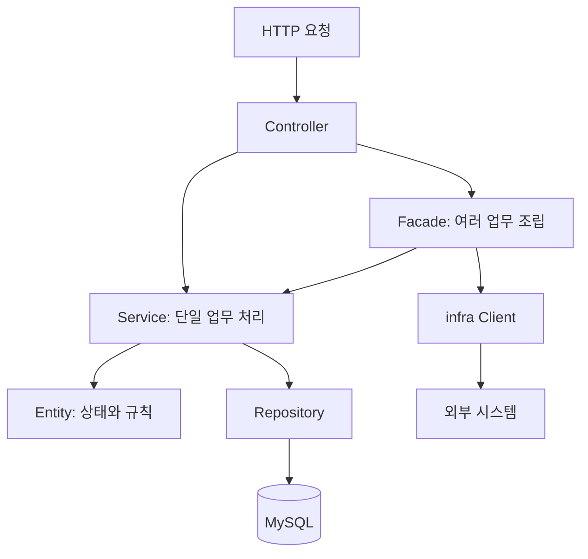
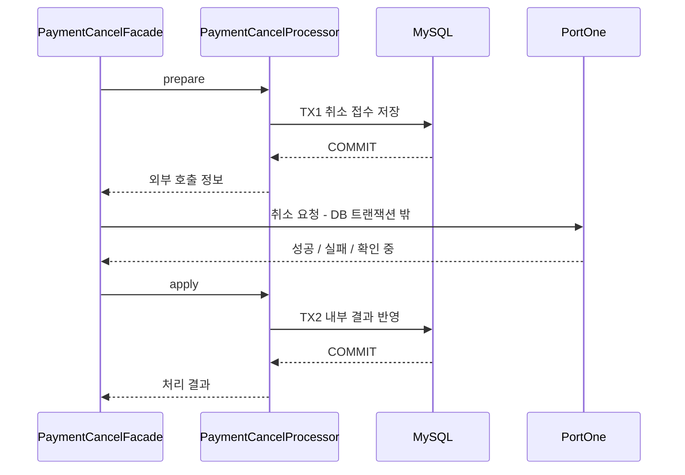

# 도메인별 패키지와 계층형 아키텍처 선택 근거

회원·상품·레시피·주문·결제를 도메인별 패키지로 나누고, 각 도메인 안에서 Controller·Facade·Service·Repository의 역할을 분리합니다.
현재는 하나의 Spring Boot 애플리케이션과 공통 MySQL에서 처리하며, 주문·결제·재고를 함께 바꾸는 흐름은 같은 DB 트랜잭션으로 조립합니다.

| 항목 | 내용 |
| --- | --- |
| 담당 | 채빈 |
| 작성·최종 확인일 | 2026-10-26 |
| 상태 | 기존 구조의 선택 근거 작성·정적 확인 완료, 팀 리뷰 대기 |
| 코드 기준 | `dev`의 `64c379d`, 문서 브랜치 `docs/project-documentation` |
| 관련 작업 | [문서 정리 #193](https://github.com/angel-kitchen/recipick/issues/193) |
| 확인 범위 | 현재 코드의 대표 요청 흐름·트랜잭션 선언·공통 인터페이스·관련 테스트 소스 |

이 문서는 기존 구조를 현재 요구사항과 비교해 설명합니다. 새로운 패키지 개편이나 실행 동작 변경은 포함하지 않습니다.

## 1. 상황

다섯 도메인을 담당자가 나눠 개발하면서도, 하나의 사용자 요청이 여러 도메인에 걸립니다.

- 주문 생성은 회원·배송 지역·장바구니·상품·재고·결제와 연결됩니다.
- 내 정보 조회는 회원·현재 배송지·이용 마트·멤버십을 함께 보여 줍니다.
- 결제 후 취소는 내부 취소 접수, 외부 PortOne 호출, 주문·결제·환불·재고 결과 반영을 구분해야 합니다.
- 관리자 감사 기록은 호출 도메인과 함께 커밋·롤백돼야 하며 기록 입력에서 민감정보를 제한해야 합니다.

각 담당자가 자기 도메인의 조회·변경 규칙을 관리하면서, 다른 도메인의 Repository를 우회 호출하지 않고
정해진 계약으로 연결할 구조가 필요합니다. 주문·재고·결제의 내부 변경은 같은 DB에서 원자적으로 처리하고,
외부 결제 호출은 DB 잠금을 잡은 채 기다리지 않는 것이 판단 기준입니다.

## 2. 후보 비교

아래는 현재 제약을 기준으로 비교한 대안입니다.

| 후보 | 이 프로젝트에서 얻는 점 | 비용·한계 |
| --- | --- | --- |
| 계층별 최상위 패키지(`controller`, `service`, `repository`) | 같은 역할의 파일을 한곳에서 찾기 쉬움 | 한 기능을 고칠 때 여러 최상위 패키지를 오가고 도메인 담당 범위가 덜 드러남 |
| **도메인별 패키지 안에 계층 분리, 단일 앱(선택)** | 담당 업무와 파일 위치가 연결되고, 도메인 간 작업을 같은 DB 트랜잭션으로 조립 가능 | 패키지만으로 접근을 강제하지 못하며 공개 메서드·의존 방향을 리뷰해야 함 |
| 도메인별 포트·어댑터를 더 세분화 | 외부 의존을 교체하는 경계를 명확히 표현 가능 | 현재 기능마다 인터페이스·변환 계층이 늘고 전체 구조를 맞추는 비용이 큼 |
| 도메인별 서비스·DB 분리 | 독립 배포와 자원 분리 가능 | 주문·결제·재고의 분산 정합성·통신 실패·운영 구성이 추가로 필요 |

현재 공유 DB 트랜잭션과 담당 도메인 구분을 함께 유지하는 두 번째 방식을 사용합니다.
외부 변경을 차단할 필요가 있는 공통 경계는 감사 기록처럼 인터페이스로 표현합니다.

## 3. 선택한 구조와 역할

```text
com.recipick
├─ domain
│  ├─ member        # 회원·관리자·지역·배송지·멤버십·감사 저장
│  ├─ product       # 마트·카테고리·상품·재고
│  ├─ recipe        # 레시피·재료·찜·자동 구성
│  ├─ order         # 장바구니·주문·마트 처리
│  └─ payment       # 결제·환불·웹훅 등 결제 업무
├─ global           # 보안·설정·응답·예외·공통 계약
└─ infra            # PortOne·Redis 등 외부 연결
```

도메인 패키지는 업무 경계이고, 그 안의 계층은 코드의 책임을 나눕니다. 모든 요청에 Facade를 추가하지는 않습니다.

| 구성 | 책임 | 이곳에 두지 않는 처리 |
| --- | --- | --- |
| Controller | HTTP 경로·입력 검증·인증 주체 수신·응답 포장 | 재고 차감·환불 판정 등 업무 규칙 |
| Facade / 트랜잭션 조립 컴포넌트 | 필요한 도메인 Service 호출, 작업 순서와 트랜잭션 경계 조립 | 다른 도메인 Repository를 통한 직접 조회·수정 |
| Service | 자기 도메인의 조회·검증·상태 변경을 공개 메서드로 제공 | 다른 도메인 Service를 묶는 조립 로직 |
| Entity | 업무 상태와 상태 전이·수량 검증 | HTTP 응답 구성·외부 API 호출 |
| Repository | 조회·저장·잠금 쿼리 | 요청 권한·복수 도메인 업무 절차 결정 |
| DTO | 요청·응답과 도메인 간 전달 계약 | 다른 도메인 엔티티의 수정 권한 전달 |
| `global` | 여러 도메인이 함께 쓰는 계약·정책·공통 처리 | 특정 도메인의 Repository 직접 접근 |
| `infra` | 외부 시스템의 통신·응답 해석·저장 접근 | 주문 취소 가능 여부 같은 업무 결정 |



위 그림은 대표적인 호출 경로입니다. 도메인 간 DTO 변환과 트랜잭션 분리는 아래 실제 사례로 구분합니다.
구체적인 패키지·호출 규칙은 [컨벤션의 패키지 구조](../convention.md#패키지-구조),
[도메인 간 호출](../convention.md#도메인-간-호출), [DTO·Controller](../convention.md#dtocontroller)를 따릅니다.

### 3-1. 주문 생성: 같은 DB 트랜잭션으로 조립

[OrderController](../../src/main/java/com/recipick/domain/order/controller/OrderController.java)가 요청을 받고,
[OrderFacade.createOrder](../../src/main/java/com/recipick/domain/order/facade/OrderFacade.java)가 `@Transactional` 경계를 엽니다.

1. 회원 행 잠금과 멱등 키·결제 대기 주문 확인을 수행합니다.
2. 회원·지역·마트·장바구니 Service로 이용 마트·배송 가능 지역·선택 항목을 확인합니다.
3. 주문을 만들고 [ProductStockService.decreaseStocks](../../src/main/java/com/recipick/domain/product/service/ProductStockService.java)로 잠금 상태에서 상품·재고를 검증하고 차감합니다.
4. 주문 상품·금액을 확정하고 결제 Service로 내부 결제 행을 생성합니다.
5. 중간에 업무 예외가 발생하면 같은 DB 트랜잭션의 변경을 롤백합니다.

주문이 상품 Repository를 직접 조회·수정하는 대신 상품 Service에 차감을 요청하므로,
상품 판매 상태·재고 검증과 잠금 방식은 상품 담당이 유지할 수 있습니다.
[ProductSummary](../../src/main/java/com/recipick/domain/product/dto/ProductSummary.java) 같은 DTO로 필요한 결과를 전달합니다.
이 흐름의 결제 행 생성은 내부 DB 처리이며 외부 PG 승인 호출과 구분합니다.

### 3-2. 결제 취소: 외부 호출 전후로 트랜잭션 분리

[PaymentCancelFacade](../../src/main/java/com/recipick/domain/payment/facade/PaymentCancelFacade.java) 전체에는 `@Transactional`이 없습니다.
[PaymentCancelProcessor](../../src/main/java/com/recipick/domain/payment/facade/PaymentCancelProcessor.java)의
`prepare`와 `apply`가 각각 트랜잭션을 담당하고,
[PortOnePaymentClient](../../src/main/java/com/recipick/infra/portone/PortOnePaymentClient.java)를 그 사이에 호출합니다.



그림은 외부 호출이 필요한 결제 후 취소 흐름입니다. 결제 전 취소나 기존 요청 재조회는 외부 호출 없이 끝날 수 있습니다.

외부 호출은 DB 롤백으로 취소할 수 없으므로 전체를 하나의 트랜잭션으로 묶지 않습니다.
실패·결과 불명 상태는 DB에 남기며, Facade가 오류 응답을 만들더라도 이미 확정한 내부 실패 상태가 지워지지 않도록
Processor의 반환 결과와 커밋 순서를 구분합니다. `Processor`는 이 흐름에서 짧은 트랜잭션을 담당하는 조립 컴포넌트입니다.
따라서 **Facade가 경계를 조립한다는 말이 모든 Facade에 트랜잭션 하나를 붙인다는 뜻은 아닙니다.**

### 3-3. 내 정보: 조회 결과를 DTO로 조립

[MemberController](../../src/main/java/com/recipick/domain/member/controller/MemberController.java)는 인증된 회원 ID로
[MemberMeFacade.getMe](../../src/main/java/com/recipick/domain/member/facade/MemberMeFacade.java)를 호출합니다.
Facade는 회원 프로필·서비스 가능 지역·마트·멤버십 정보를 읽어 응답 DTO를 구성합니다.
이 Facade는 읽기 전용 트랜잭션을 사용하며, 조회만으로 현재 배송지나 이용 마트를 변경하지 않습니다.

### 3-4. 공통 계약과 이벤트

[AdminAuditRecorder](../../src/main/java/com/recipick/global/audit/AdminAuditRecorder.java)는 `global/audit`의 인터페이스이며,
[AdminAuditService](../../src/main/java/com/recipick/domain/member/service/AdminAuditService.java)가 회원 도메인에서 구현합니다.
호출하는 도메인은 저장 구현을 직접 주입하지 않고 인터페이스에 의존합니다.
구현은 `MANDATORY`로 기존 쓰기 트랜잭션에 참여하며 감사 저장 실패도 업무와 함께 롤백합니다.
현재는 공통 기록 기반이 병합된 상태이며 각 업무의 실제 기록 호출 연결은 별도 작업입니다.

이벤트는 알림·통계처럼 일시적 불일치를 허용할 수 있는 후처리에 사용하는 정책입니다.
주문·결제·재고와 감사 기록의 원자적 변경은 동기 호출로 처리합니다.
이 문서가 이벤트 기반 후처리 전체의 구현 완료를 의미하지는 않습니다.

## 4. 트레이드오프와 재검토 조건

| 얻는 점 | 감수하는 비용·관리 방법 |
| --- | --- |
| 기능과 담당 파일을 도메인 안에서 함께 찾을 수 있음 | 공통 기능의 소유자가 모호해질 수 있어 `global`은 실제 공통 계약·처리로 제한 |
| 내부 상태 변경을 같은 DB에서 원자적으로 처리 | 공유 DB와 배포 단위에 결합됨. 장기 트랜잭션과 외부 호출을 분리 |
| 공개 Service·DTO로 도메인 간 협업 | DTO·공개 메서드 변경 시 호출자도 확인해야 하므로 문서·테스트와 함께 변경 |
| Facade에서 복수 도메인 작업 순서를 확인 가능 | Facade가 커질 수 있어 트랜잭션 단계별 책임을 분리하고 공통 로직은 담당 Service로 유지 |
| 필요한 경계에 인터페이스 적용 | 모든 의존을 컴파일 시 강제하는 모듈 분리는 아님. 코드 리뷰로 경계 유지 |

현재 Java 패키지 구조만으로 모든 잘못된 참조를 막지는 못합니다. 다른 도메인 엔티티 타입을 import하는 경우가 있어도
타입 참조와 다른 도메인 Repository를 직접 조회·수정하는 동작을 구분해 검토합니다.
도메인 간 전달은 ID·DTO 등으로 제한하고 실제 조회·변경은 공개 계약을 통하도록 유지합니다.

독립 배포·장애 격리 필요가 커지거나 외부 구현 교체가 반복된다면 모듈 경계 강화·포트 분리·서비스 분리를 다시 검토합니다.
이 구조의 성능 우위를 측정한 결과는 아직 없으며, 성능 개선 효과는 별도 보고서에서 전후 수치로 확인합니다.

## 5. 확인 결과와 검증 범위

문서 작성 시 다음 소스와 선언을 정적으로 확인했습니다. 애플리케이션 코드는 변경하지 않았으며
이 문서 작업에서 실행 테스트를 새로 돌리지는 않았습니다.

| 확인 항목 | 확인한 코드·근거 | 확인 결과 |
| --- | --- | --- |
| 업무·공통·외부 연결의 분리 | `domain/{member,product,recipe,order,payment}`, `global`, `infra` | 실제 패키지 위치 확인 |
| 복수 도메인 트랜잭션 | `OrderFacade.createOrder`, `ProductStockService.decreaseStocks` | 바깥 트랜잭션과 참여 Service 선언 확인 |
| 외부 결제 호출 경계 | `PaymentCancelFacade`, `PaymentCancelProcessor.prepare/apply` | 외부 호출을 사이에 둔 두 트랜잭션 확인 |
| 읽기 전용 조립 | `MemberController`, `MemberMeFacade` | Controller의 위임·Facade의 조회·DTO 조립 확인 |
| 감사 기록 계약 | `AdminAuditRecorder`, `AdminAuditService.record` | 공통 인터페이스·기존 쓰기 트랜잭션 필수 조건 확인 |

실행 동작을 확인할 때 사용할 기존 테스트는 다음과 같습니다. 아래 링크는 검증 시나리오의 근거이며 이번 문서 작성의 실행 결과로 집계하지 않습니다.

- [OrderCreateIntegrationTest](../../src/test/java/com/recipick/domain/order/controller/OrderCreateIntegrationTest.java): 주문 생성 API와 내부 상태 검증.
- [OrderCreateConcurrencyTest](../../src/test/java/com/recipick/domain/order/facade/OrderCreateConcurrencyTest.java): 주문 생성 경합 검증.
- [PaymentCancelFacadeIntegrationTest](../../src/test/java/com/recipick/domain/payment/facade/PaymentCancelFacadeIntegrationTest.java): 외부 호출 결과별 커밋·상태 유지·동일 키 재요청 검증. PortOne Client는 Mock입니다.
- [AdminAuditIntegrationTest](../../src/test/java/com/recipick/domain/member/service/AdminAuditIntegrationTest.java): 감사 저장 실패·후속 업무 실패 시 전체 롤백 검증.
- [MemberMeIntegrationTest](../../src/test/java/com/recipick/domain/member/controller/MemberMeIntegrationTest.java): 회원 정보 조회 응답 검증.

전체 테스트는 저장소 루트에서 `./gradlew test`로 실행합니다. 패키지 경계 전체를 자동 검사하는 아키텍처 테스트는 이번 문서 범위에 포함하지 않았습니다.

## 6. 관련 규칙

- [요구사항](../requirement.md): 주문 생성·결제 취소·관리자 감사 로그의 정합성 정책.
- [패키지 구조](../convention.md#패키지-구조): 도메인별 책임과 공통·외부 연결의 위치.
- [도메인 간 호출](../convention.md#도메인-간-호출): Service 공개 계약·Facade 조립·동기 기록.
- [트랜잭션·동시성](../convention.md#트랜잭션동시성): 동일 DB 트랜잭션·외부 호출 분리·잠금 순서.
- [DTO·Controller](../convention.md#dtocontroller): 입력·응답 책임과 엔티티 응답 제한.
- [문서 목차](../README.md): 개별 인증·동시성·성능 근거의 작성 위치.
