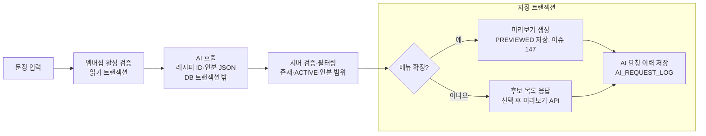

# AI 자연어 장보기 Spring AI 설계 검토

작성일: 2026-10-25 · 작성자: 김준희

> 초기 검토 당시의 Spring AI·OpenAI 도입 제안입니다. 현재 구현은 Anthropic SDK 기반 Claude 및 SDK Tool Calling이며, 이 문서의 예시 코드는 채택된 구현을 뜻하지 않습니다. 현재 선택·검증 결과는 [AI ADR](adr/recipe-ai.md)과 [모델 선택](ai/model-selection.md)을 따릅니다.

## 결론

튜터님 흐름은 그대로 두되, 벡터 검색(사전준비·kNN)은 지금 단계에서 빼는 것을 권장한다. 등록 레시피 100개 전체를 프롬프트에 넣고 Spring AI `ChatClient` 한 번 호출로 레시피 ID·인분을 구조화 JSON으로 받으면 된다.

- 레시피가 100개로 고정이라 카탈로그(ID·이름·한식/양식·요리 유형·주재료)가 3~4천 토큰 수준이다.
- 요구사항의 "등록 레시피 100개 안에서 추천"을 모델이 카탈로그 안에서 고르는 것으로 직접 만족한다.
- 임베딩 모델, 벡터 저장소, 사전준비 배치, ERD 변경이 모두 필요 없다.
- 다이어그램의 "kNN 사용여부 = No" 분기를 키워드 검색 대신 이 방식으로 구현하는 셈이다. 레시피가 수천 개로 늘면 후보 검색 부분만 kNN으로 교체하면 되고, OpenAI는 임베딩도 같은 키로 되므로 그때도 공급자를 추가할 필요가 없다.

검토 기준은 `docs/requirement.md` 2차 AI 항목, `docs/convention.md`, ERD의 `AI_REQUEST_LOG`, 미리보기 이슈 #147, Spring AI 1.1.x 소스 코드, OpenAI 공식 모델 문서다. 공급자는 OpenAI(GPT-6 계열) 기준이다.

## 요구사항·현재 코드에 맞춘 처리 흐름

요구사항은 "AI는 메뉴·인분·조건만 분석하고 재료량·수량·가격·재고·멤버십은 서버가 검증"이다. ERD와 엔티티에 `AI_REQUEST_LOG`가 이미 있고 미리보기 API는 #147로 진행 중이므로, AI 기능은 미리보기 앞단만 만들면 된다.



AI 호출이 실패하거나 응답을 파싱하지 못해도 같은 이력에 실패 사유를 남기고 오류로 응답한다.

1. **입력** `POST /api/ai-requests`, 본문 `{ text }`, 권한 MEMBERSHIP. recipe 도메인 Facade가 멤버십 서비스로 활성 여부를 먼저 확인한다(요구사항 "자동 장바구니·AI 요청 시 멤버십 안내").
2. **AI 호출** `infra/ai`의 클라이언트가 `ChatClient`로 문장을 보낸다. system 프롬프트에 100개 레시피의 ID·이름·한식/양식·요리 유형·주재료를 넣고, 응답은 OpenAI 구조화 출력(JSON 스키마)로 `{ intent, menus:[{recipeId, servings}], unmatched:[...], conditions }` 형태를 강제한다. DB 트랜잭션 밖에서 호출한다.
3. **서버 필터링** 레시피 서비스가 ID 존재·ACTIVE·자동 장보기 지정 여부를 검증한다. 메뉴 1~5개·인분 1~10·중복은 기존 RECIPE-010~012 규칙을 그대로 쓴다. AI 응답 중 ID와 인분 외의 값은 쓰지 않는다.
4. **미리보기 연결** 메뉴가 확정되면 #147의 미리보기 로직을 Facade에서 호출해 `PREVIEWED` 요청을 만든다. "국물요리 추천해줘"처럼 메뉴가 확정되지 않으면 후보 목록을 돌려주고, 사용자가 고른 뒤 기존 미리보기 API로 이어간다. 판정 결과는 오류가 아니라 `status` 필드로 내려준다.
5. **이력** 성공·실패 모두 `AI_REQUEST_LOG`에 원문·분석 JSON·연결 레시피·실패 사유를 저장한다. 관리자 조회는 `GET /api/admin/ai-requests`(SUPER_ADMIN)로 둔다.

트랜잭션은 컨벤션대로 `읽기 → AI 호출(트랜잭션 밖) → 저장 트랜잭션` 세 단계로 나누고, 락을 잡은 채 AI를 호출하지 않는다.

## 설계 비교: 카탈로그 프롬프트 vs kNN

100개 규모에서는 A가 비용과 복잡도 모두 낮고, B는 레시피가 수천 개로 늘었을 때 가치가 생긴다.

| 항목 | A. 카탈로그 프롬프트 (권장) | B. 튜터님 kNN 방식 |
| --- | --- | --- |
| AI 호출 | 1회 (추출 + 매칭) | 2회 (추출 + 임베딩) |
| 임베딩 모델 | 불필요 | 필요. OpenAI면 같은 키로 `text-embedding-3-small`을 쓸 수 있어 공급자 추가는 없다. Spring AI 기본값은 구세대 `text-embedding-ada-002`라 명시해야 한다 |
| 벡터 저장소 | 불필요 | 필요. Spring AI에 MySQL 스토어가 없고, Redis 스토어는 RediSearch 모듈이 필요해 현재 `redis:7.4` 이미지로는 동작하지 않는다. SimpleVectorStore는 인메모리 테스트용이다 |
| 사전준비 | 없음 | 레시피 100개 임베딩 배치, 레시피 수정 시 재임베딩 |
| ERD 변경 | 없음 | 벡터 저장 위치 결정과 테이블 추가 |
| 동의어 처리 (참치 → 참치캔) | 모델이 카탈로그를 보고 판단 | 임베딩 유사도 |
| 프롬프트 크기 | 레시피당 30~40 토큰, 100개면 약 3~4천 토큰 | 추출 프롬프트만 |
| 확장성 | 수천 개부터 부담 | 수만 개도 가능 |

A에서 system 프롬프트(카탈로그)는 OpenAI 프롬프트 캐시가 별도 설정 없이 자동 적용된다. 매 요청 앞부분이 같아야 하므로 카탈로그를 system에, 사용자 문장을 user에 두고, 적용 여부는 응답 usage의 cached_tokens로 확인한다.

## Spring AI 1.1.x + GPT-6 주의점

아래는 Spring AI 1.1.x 소스와 OpenAI 공식 문서로 확인한 내용이다. 특히 temperature 기본값과 출력 토큰 옵션 이름은 그대로 두면 400 오류가 난다.

| 항목 | 확인된 사실 | 조치 |
| --- | --- | --- |
| 버전 | Spring Boot 3.5.x에는 Spring AI 1.1.x만 맞고 Maven Central 최신은 1.1.8이다. 2.x는 Boot 4 전용이다 | `spring-ai-bom:1.1.8` + `spring-ai-starter-model-openai` |
| 모델 | Spring AI 기본값은 `gpt-4o-mini`로 구세대다. 현재 라인업은 `gpt-6-astra`, `gpt-6.1-sol`(입력 $2 / 출력 $10, 1M 토큰 기준), `gpt-6-luna`(입력 $0.1 / 출력 $0.5)이고 셀 다 Chat Completions를 지원한다 | 추출은 `gpt-6-luna`로 시작하고 매칭 품질이 모자라면 `gpt-6.1-sol`로 올린다 |
| temperature | Spring AI 기본 옵션이 0.7을 항상 보내고, 런타임 옵션에 null을 넣어도 `ModelOptionsUtils.merge`가 기본값으로 다시 채운다. OpenAI는 reasoning effort가 none이 아니면 temperature·top_p를 빼라고 명시한다 | 자동 구성이 `@ConditionalOnMissingBean`이므로 `OpenAiChatModel` 빈을 직접 등록해 temperature 없이 기본 옵션을 만든다 |
| reasoning_effort | `gpt-6-luna`는 none·low·medium(기본)·high·xhigh·max를 지원하고, `gpt-6.1-sol`은 none·minimal을 지원하지 않는다 | 단순 추출이므로 `none`(sol이면 `low`)으로 지정해 지연과 비용을 줄인다 |
| 출력 토큰 한도 | 추론 모델은 `max_tokens` 대신 `max_completion_tokens`를 써야 하고 추론 토큰도 여기에 포함된다. 둘을 같이 쓰면 API 오류다 | `max-completion-tokens: 4096` |
| 구조화 출력 | OpenAI 네이티브 JSON 스키마(Structured Outputs)를 지원한다. `ResponseFormat` JSON_SCHEMA + `BeanOutputConverter.getJsonSchema()`로 연결하며, 모든 필드가 required여야 하고 BeanOutputConverter가 이를 자동으로 붙인다 | 스키마를 강제하고, `finishReason`이 `stop`이 아닌 경우(`length`, `content_filter`)를 실패로 기록한 뒤 AI 접두어 에러 코드로 응답한다 |
| 도구 호출 | GPT-6 계열은 Chat Completions에서 도구 호출이 제한된다(luna는 effort none에서만, 6.1 sol은 Responses API만). Spring AI 1.1.x OpenAI 모듈은 Chat Completions를 호출한다 | 이 기능은 도구 호출을 쓰지 않으므로 영향이 없다. 도구 호출이 필요해지면 그때 Spring AI 2.x를 검토한다 |
| 재시도 | `spring.ai.retry.max-attempts` 기본값 10, 백오프 최대 3분이라 사용자 요청이 수 분 매달릴 수 있다 | 2로 낮춘다 |
| 타임아웃 | Spring AI가 Boot의 `RestClient.Builder`를 쓴다 | `spring.http.client.connect-timeout`·`read-timeout`을 건다. 예외는 PortOne 클라이언트처럼 COMMON-008·009로 매핑한다 |
| 테스트 | Testcontainers 통합 테스트가 실제 API를 부르면 안 된다 | `ChatModel`을 `@MockitoBean`으로 대체하고 테스트 프로필의 `spring.ai.openai.api-key`에 더미 값을 둔다 |
| 로그 | 원문 저장은 요구사항이다 | API 키는 로그에 남기지 않는다 |

## 설정·코드 예시

의존성은 BOM과 OpenAI 스타터 두 줄이고, 설정은 모델·reasoning effort·출력 토큰·재시도·타임아웃만 바꾼다. temperature는 설정으로 비울 수 없어 빈으로 등록한다.

```groovy
dependencyManagement {
    imports { mavenBom 'org.springframework.ai:spring-ai-bom:1.1.8' }
}
implementation 'org.springframework.ai:spring-ai-starter-model-openai'
```

```yaml
spring:
  ai:
    openai:
      api-key: ${OPENAI_API_KEY}
      chat.options:
        model: gpt-6-luna
        reasoning-effort: none
        max-completion-tokens: 4096
    retry.max-attempts: 2
  http.client:
    connect-timeout: 3s
    read-timeout: 30s
```

```java
@Bean
OpenAiChatModel openAiChatModel(OpenAiApi api, OpenAiChatProperties props,
        RetryTemplate retryTemplate, ToolCallingManager toolCallingManager) {
    // GPT-6 계열은 reasoning effort가 none이 아니면 temperature를 거절하므로 기본 옵션에서 뻐다
    var options = OpenAiChatOptions.builder()
            .model(props.getOptions().getModel())
            .reasoningEffort(props.getOptions().getReasoningEffort())
            .maxCompletionTokens(props.getOptions().getMaxCompletionTokens())
            .build();
    return OpenAiChatModel.builder().openAiApi(api).defaultOptions(options)
            .toolCallingManager(toolCallingManager).retryTemplate(retryTemplate).build();
}
```

호출은 `BeanOutputConverter`로 만든 JSON 스키마를 OpenAI Structured Outputs에 걸어 응답 형태를 강제한다. 응답 record는 `infra/ai`에 둔다.

```java
var converter = new BeanOutputConverter<>(AiMenuExtraction.class);
var format = new ResponseFormat(ResponseFormat.Type.JSON_SCHEMA, converter.getJsonSchema());

AiMenuExtraction result = chatClient.prompt()
        .system(catalogPrompt)
        .user(text)
        .options(OpenAiChatOptions.builder().responseFormat(format).build())
        .call()
        .entity(converter);
```

## 문서 영향과 팀 결정 사항

A안이면 ERD 변경이 없다. AI 접두어 에러 코드와 API 명세를 `docs/requirement.md`·`docs/convention.md`에 먼저 추가하고 `python3 .coderabbit/split_requirements.py`를 돌린다. #147의 미리보기 로직은 Facade에서 재사용할 수 있게 서비스 메서드로 분리해 달라고 보민님께 요청한다.

- [ ] kNN 없이 카탈로그 프롬프트 방식으로 시작할지
- [ ] 모델을 `gpt-6-luna`로 시작할지, 처음부터 `gpt-6.1-sol`로 갈지
- [ ] 장보기·조건 추천을 `POST /api/ai-requests` 하나로 받고 `status`로 구분할지, 엔드포인트를 둘로 나눌지
- [ ] 일부 메뉴만 매칭됐을 때 미리보기를 진행할지, 사용자 확인을 받을지
- [ ] AI 접두어 에러 코드 번호와 메시지 확정(문장 이해 실패, 매칭 레시피 없음 등)
- [ ] 과제용 5개(프롬프트 테이블, 도구 호출 2개, 메트릭·대시보드)를 정말 넣을지. 권장은 넣지 않기
- [ ] `AI_REQUEST_LOG` 토큰·지연 컴럼을 ERD에 추가할지(체크리스트 3-4, 권장은 추가)

## 과제 체크리스트 대응

원칙은 하나다. 과제 체크리스트 항목이라도 우리 서비스에 꼭 필요하지 않으면 넣지 않기를 권장한다. 요구사항 밖 기능은 구현·테스트·리뷰 부담만 늘리고, 넣지 않을 때는 이 표의 이유를 그대로 제출 문서에 적으면 된다. 15개 중 8개는 서비스에 필요하고(4개는 이미 포함), 2개는 있으면 좋고, 5개는 과제용이다. 과제용 항목도 꼭 넣어야 할 때의 최소 방법을 함께 적었다.

| 항목 | 서비스 필요성 | 설계 대비 | 넣는 방법 (과제용은 꼭 넣어야 할 때의 최소 방법) |
| --- | --- | --- | --- |
| 1-1 LLM 응답을 스키마로 파싱해 DB 저장 | 필요 | 이미 포함 | AI 이력 조회 요구사항 그 자체다. Structured Outputs로 받은 `AiMenuExtraction`을 `AI_REQUEST_LOG.parsed_result`(json)에 저장한다. 추가 작업 없음 |
| 1-6 모델 선택 근거 문서화 | 필요 | 이미 포함 | 이 문서의 주의점 표와 비교 표를 README 또는 ADR로 옮긴다 |
| 3-2 AI 장애가 핵심 서비스에 영향 없음 | 필요 | 이미 포함 | AI는 별도 엔드포인트, 트랜잭션 밖, 락 없음이라 미리보기·주문·결제는 AI 없이 동작한다. `ChatModel`을 모킹해 예외를 던져도 미리보기·주문 API가 정상인지 확인하는 테스트 하나만 추가 |
| 3-3 환각 방어 1가지 이상 | 필요 | 이미 포함 | 서버가 recipeId 존재·ACTIVE·인분 범위를 검증하고 카탈로그 밖 ID는 거부한다. 수량·가격은 서버 계산이다. 스키마에 enum·범위 제약을 더 걸면 1차 방어가 하나 더 생긴다 |
| 1-2 max_tokens·temperature 명시와 근거 | 필요 | 추가 작업 | 400 오류와 비용 때문에 어차피 정해야 한다. `max-completion-tokens: 4096`을 두고, temperature는 `gpt-6-luna` + `reasoning_effort: none`에서만 보낼 수 있으니 `temperature: 0`을 명시한다(추출은 결정적이어야 함). `gpt-6.1-sol`로 바꾸면 빼야 한다는 근거를 README에 적는다 |
| 1-3 프롬프트 템플릿 2개 이상 분기 | 필요 | 추가 작업 | 장보기 추출과 조건 추천은 지시문이 달라 서비스 관점에서도 나눠야 한다. 템플릿을 `resources/prompts/` 아래 두 파일로 두고 엔드포인트도 둘로 나눈다(결정 사항 3번) |
| 3-1 LLM 장애 시 Fallback 2가지 이상 | 필요 | 추가 작업 | 유료 회원 기능이라 장애 시 안내가 필요하다. (a) 타임아웃·5xx는 기존 레시피명 키워드 검색으로 후보를 제시한다(튜터님 다이어그램의 kNN=No 분기). (b) 429·반복 실패는 즉시 안내 응답을 내고 직접 선택으로 유도한다. 서킷브레이커(Resilience4j)는 필요해지면 그때 넣는다 |
| 3-4 토큰·응답 시간·에러율 로깅 | 필요 | 설계 변경 | 비용 관리에 필요하고 AI 이력 조회와 같은 테이블이다. `AI_REQUEST_LOG`에 `model`, `prompt_tokens`, `completion_tokens`, `latency_ms`, `error_type`를 추가한다(ERD 변경, 문서 먼저). 값은 `ChatResponse.getMetadata().getUsage()`에서 읽는다 |
| 2-2 실시간 데이터를 포함한 자연어 응답 | 있으면 좋음 | 추가 작업 | 추천 결과에 한 줄 설명이 있으면 UX에 도움이 된다. 구조화 스키마에 `message` 필드 하나를 추가하면 되고 도구 호출 없이도 충족된다 |
| 1-5 프롬프트 개선 이력 3회 | 있으면 좋음 | 추가 작업 | 서비스 코드에 영향이 없는 문서 작업이다. 3-4 로그로 토큰 변화를 재고 `docs/ai-prompt-history.md`에 동기·토큰 변화·품질 변화·다음 방향을 기록한다 |
| 1-4 프롬프트를 재배포 없이 수정 | 과제용 | 설계 변경 | 넣지 않기 권장. 5명 팀·레시피 100개 규모에서는 재배포 비용이 낮고 프롬프트 변경도 드물다. 꼭 넣어야 하면 `ai_prompt_template`(key, version, content, active) 테이블 + SUPER_ADMIN 수정 API + 60초 캐시가 최소 구성이다(ERD 변경) |
| 2-1 `@Tool`로 백엔드 API 2개 이상 연동 | 과제용 | 설계 변경 | 넣지 않기 권장. 조건 추천은 카탈로그 1회 호출로 충분하고, 도구 호출은 호출 수·지연·비용이 늘고 모델이 `gpt-6-luna` + effort none으로 묶인다(Spring AI 1.1.x는 Chat Completions). 꼭 넣어야 하면 조건 추천만 읽기 전용 도구 2개(`searchRecipes`, `checkIngredientAvailability`)로 구현하고 장바구니 담기 같은 쓰기 도구는 두지 않는다 |
| 2-3 Tool 실패 컨텍스트를 LLM에 전달 | 과제용 | 추가 작업 | 2-1을 넣을 때만 해당한다. Spring AI 기본 동작이 예외 메시지를 도구 결과로 모델에 돌려주므로(`DefaultToolExecutionExceptionProcessor`), 도구 안에서 타임아웃·예외를 "재고 확인이 어렵습니다"로 바꽸고 안내문이 나오는지 테스트한다 |
| 3-5 메트릭 수집 도구 선택과 근거 | 과제용 | 추가 작업 | 넣지 않기 권장. 3-4 로그로 비용 파악은 충분하다. 꼭 넣어야 하면 `spring-boot-starter-actuator` + `micrometer-registry-prometheus` 두 의존성만으로 Spring AI가 `gen_ai.client.operation`(지연)·`gen_ai.client.token.usage`(토큰)를 자동 수집한다. 근거: 코드 없이 자동, Boot 표준 스택 |
| 3-6 모델별 누적 토큰·P95·에러율 대시보드 | 과제용 | 추가 작업 | 3-5를 넣을 때만 해당한다. docker-compose에 Prometheus·Grafana를 추가하고, P95는 `management.metrics.distribution.percentiles-histogram.gen_ai.client.operation=true`로 히스토그램을 켜서 그린다. 토큰 카운터에 모델 태그가 없으면 `AI_REQUEST_LOG` 집계로 보완한다 |

과제용 5개(1-4, 2-1, 2-3, 3-5, 3-6)를 빼면 설계 변경은 3-4의 로그 컴럼 추가 하나로 줄고, 모델도 `gpt-6-luna`에 묶이지 않는다. 과제 평가 때문에 넣어야 한다면 도구 호출(2-1·2-3)과 메트릭·대시보드(3-5·3-6)를 한 묶음씩 넣고, 도구 호출은 조건 추천에만 적용해 자연어 장보기 추출은 1회 호출로 유지한다.

## 출처

- [Spring AI GitHub: 버전별 Spring Boot 호환 표](https://github.com/spring-projects/spring-ai)
- [Spring AI 2.0.0 GA 공지 (2026-06-12, Boot 4 필요)](https://spring.io/blog/2026/06/12/spring-ai-2-0-0-GA-available-now/)
- [Spring AI 1.1 OpenAI Chat 문서 (옵션, Structured Outputs, max_completion_tokens)](https://docs.spring.io/spring-ai/reference/1.1/api/chat/openai-chat.html)
- [Spring AI 1.1 임베딩 구현체 목록](https://docs.spring.io/spring-ai/reference/1.1/api/embeddings.html)
- [Spring AI 1.1 벡터 스토어 목록](https://docs.spring.io/spring-ai/reference/1.1/api/vectordbs.html)
- [Spring AI Redis 벡터 스토어 요구사항](https://docs.spring.io/spring-ai/reference/1.0/api/vectordbs/redis.html)
- [Spring AI 1.1.x 소스: OpenAiChatProperties (기본 모델 gpt-4o-mini, temperature 0.7)](https://github.com/spring-projects/spring-ai/blob/1.1.x/auto-configurations/models/spring-ai-autoconfigure-model-openai/src/main/java/org/springframework/ai/model/openai/autoconfigure/OpenAiChatProperties.java)
- [Spring AI 1.1.x 소스: OpenAiChatAutoConfiguration (@ConditionalOnMissingBean)](https://github.com/spring-projects/spring-ai/blob/1.1.x/auto-configurations/models/spring-ai-autoconfigure-model-openai/src/main/java/org/springframework/ai/model/openai/autoconfigure/OpenAiChatAutoConfiguration.java)
- [OpenAI 모델 목록 (GPT-6 Astra · GPT-6.1 Sol · GPT-6 Luna)](https://developers.openai.com/api/docs/models)
- [OpenAI GPT-6 사용 가이드 (reasoning effort none, temperature 제거, Chat Completions 도구 제한)](https://developers.openai.com/api/docs/guides/latest-model)
- [OpenAI gpt-6-luna 모델 페이지 (가격·엔드포인트)](https://developers.openai.com/api/docs/models/gpt-6-luna)
- [OpenAI gpt-6.1-sol 모델 페이지 (가격·엔드포인트)](https://developers.openai.com/api/docs/models/gpt-6.1-sol)
- [OpenAI 임베딩 가이드 (text-embedding-3-small)](https://developers.openai.com/api/docs/guides/embeddings)
- [Maven Central spring-ai-bom 버전 목록](https://repo1.maven.org/maven2/org/springframework/ai/spring-ai-bom/maven-metadata.xml)
