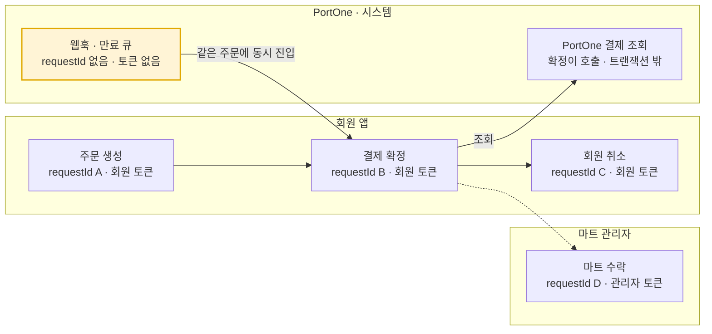

# 주문 추적성 개선 도입 검토

작성일 2026-10-25. MDC·Correlation ID, 구조화 로그, Micrometer 지표를 주문 흐름에 넣을지, 넣는다면 어떤 문제를 보고 어떻게 해결할지 정리한다.

## 1. 배경과 문제

지금은 주문 한 건이 어디서 왜 멈췄는지를 로그로 알 수 없다. 2026-10-25 기준 `feature/order-admin-accept` 브랜치의 상태는 아래와 같다.

- 로그 설정 파일, MDC, 요청 식별자가 없다. Spring Boot 기본 콘솔 패턴만 쓴다.
- 로그 문장은 전체 14개이고 order 도메인은 0개다. 있는 로그는 payment Facade, PortOne 클라이언트, 전역 예외 처리기에만 있다.
- 장애 시 추적 경로는 `order_status_history`와 `payment.status`뿐이다. DB 이력은 성공한 전이만 남기고, 실패와 전이 사이에 걸린 시간은 남기지 않는다.

주문 한 건의 생애는 여러 HTTP 요청과 외부 호출에 걸친다. 요청마다 스레드와 시각이 다르고, 웹훅과 만료 큐는 우리가 발급한 요청 ID를 가지고 오지 않는다.



요청 ID는 요청마다 바뀌고 웹훅과 만료 큐에는 아예 없으므로, 주문 전체를 잇는 키는 orderId뿐이다.

로그에만 남을 수 있는데 지금은 남지 않거나 주문과 묶이지 않는 상황은 다음과 같다.

| 상황 | 지금 보이는 것 | 알 수 없는 것 |
| --- | --- | --- |
| 결제 확정 경합. 프론트 재시도, 웹훅, 만료 큐가 같은 주문에 동시에 들어온다 | 최종 상태 한 줄 | 어느 요청이 APPROVED를 반영했고 어느 요청이 ALREADY_PAID, ALREADY_CLOSED로 끝났는지 |
| 락 대기 초과 COMMON-010 | 스택 트레이스 | 어떤 주문이 어느 구간에서 몇 초를 기다렸는지 |
| PG에 돈이 묶인 상태. AMOUNT_MISMATCH, 만료 뒤 늦은 승인 | WARN 한 줄 | 건수 추이, 알림 가능 여부 |
| PortOne 장애, timeout | PortOne 결제 ID만 있는 WARN | 어느 주문, 어느 회원의 요청이었는지 |
| 멱등 재시도 | 없음 | 같은 키 재시도가 200으로 돌아왔는지 COMMON-011로 끝났는지 |

## 2. 도입 기술과 각각이 해결하는 것

핵심은 "주문 ID로 묶고, 요청 ID로 가른다"이다. 생성형 Correlation ID 하나로는 웹훅과 만료 큐가 묶이지 않으므로, 주문 전체 흐름의 단일 키는 `orderId`다. 요청 ID는 한 요청 안의 로그를 묶고 같은 주문에 동시에 들어온 요청들을 구분하는 용도다.

| 기술 | 해결하는 문제 | 우리 코드에서 바뀌는 것 | 판단 |
| --- | --- | --- | --- |
| MDC + requestId | 한 요청의 로그가 동시 요청과 섞인다. 전역 예외 로그를 요청과 이을 수 없다 | 서블릿 필터 1개, 응답 헤더 `X-Request-Id` | 지금 도입 |
| MDC + orderId, memberId | 주문 단위로 로그를 모을 수 없다. PortOne WARN이 주문과 묶이지 않는다 | 상태를 바꾸는 Facade 진입점에서 put, 인증 필터에서 주체 put | 지금 도입 |
| 구조화 JSON 로그 | 여러 인스턴스의 로그를 필드로 검색할 수 없다 | 운영 프로필 설정 1줄, 의존성 없음 | 수집기 도입 시 |
| Micrometer Timer, Counter | 단계별 처리 시간과 결과 분포를 수치로 볼 수 없다 | actuator 의존성, 측정 지점 6곳 | 다음 단계 |
| 복합 인덱스 | 목록 조회 지연 | 이미 적용됨 | EXPLAIN 확인으로 대체 |

인덱스는 이미 들어가 있다. `idx_orders_member_id`는 InnoDB 보조 인덱스 끝에 PK가 붙어 회원 목록의 `order by id desc`까지 인덱스 순서로 풀리고, 관리자 목록은 `idx_orders_mart_id_mart_status` 복합 인덱스가 있다. 이력 테이블의 `order_id`는 FK 인덱스가 자동 생성되고, `payment.order_id`와 `webhook_event.webhook_id`는 UNIQUE다. 남은 후보는 회원 목록의 상태 그룹 필터 정도인데 회원 한 명의 주문 수가 적어 효과가 작다. 수치 없이 인덱스를 더하지 않는다.

## 3. 적용 설계

MDC 키는 세 종류로 제한한다. 토큰, 휴대전화 같은 로그 금지 항목은 넣지 않는다.

| 키 | 넣는 자리 | 지우는 자리 |
| --- | --- | --- |
| requestId | `RequestIdFilter`. 서블릿 필터 최상위에 등록해 SecurityFilterChain 밖에 둔다. 인증 실패 401 응답에도 붙는다 | 같은 필터의 finally에서 `MDC.clear()` |
| memberId, adminId | `JwtAuthenticationFilter` 토큰 파싱 직후 | 위와 같음 |
| orderId | 상태를 바꾸는 Facade 진입점. 주문 생성 직후, 결제 확정, 취소, 마트 수락, 웹훅 핸들러 | `MDC.putCloseable` try-with-resources |

```java
@Component
@Order(Ordered.HIGHEST_PRECEDENCE)
public class RequestIdFilter extends OncePerRequestFilter {

    @Override
    protected void doFilterInternal(HttpServletRequest request, HttpServletResponse response, FilterChain chain)
            throws ServletException, IOException {
        String requestId = UUID.randomUUID().toString();
        MDC.put("requestId", requestId);
        response.setHeader("X-Request-Id", requestId);
        try {
            chain.doFilter(request, response);
        } finally {
            MDC.clear();
        }
    }
}
```

설정과 부수 변경은 네 가지다.

- `logging.pattern.correlation: "[%X{requestId:-}] [order=%X{orderId:-}] "` 한 줄. Boot 기본 콘솔 패턴에 이 자리가 예약되어 있다.
- 운영 프로필에서 `logging.structured.format.console: ecs`. Boot 3.5.16이라 추가 의존성이 없고 MDC가 자동으로 필드에 들어간다.
- CORS `exposedHeaders`에 `X-Request-Id` 추가. 프론트가 헤더를 읽어 문의 시 전달한다. 지금 설정에는 exposed 헤더가 없다.
- INFO 로그는 흐름 경계에만 남긴다. 주문 생성 결과와 멱등 재시도 여부, 결제 확정 outcome, 취소 요청과 PG 결과, 마트 수락. 전이 자체는 `order_status_history`에 맡긴다.

Micrometer는 `spring-boot-starter-actuator` 하나를 추가하고, AOP의 `@Timed` 대신 결과 태그를 붙일 수 있는 수동 기록을 쓴다. 우리 파이프라인은 단계 경계가 Facade와 Processor로 이미 나뉘어 있어 측정 지점이 명확하다.

| 지표 | 위치 | 태그 |
| --- | --- | --- |
| `order.create` | `OrderFacade.createOrder` 전체 | result: created, retried, error |
| `stock.decrease` | `ProductStockService.decreaseStocks` 재고 잠금 구간 | 없음 |
| `http.client.requests` | PortOne RestClient, 자동 계측 | uri 템플릿, status |
| `payment.confirm` | `PaymentConfirmProcessor.process` | outcome |
| `order.accept` | `OrderService.acceptByMart` | 없음 |
| `order.lock.timeout` | `GlobalExceptionHandler`의 COMMON-010 카운터 | 없음 |

```java
Timer.Sample sample = Timer.start(meterRegistry);
PaymentApprovalOutcome outcome = paymentConfirmProcessor.process(orderId, portOnePayment);
sample.stop(meterRegistry.timer("payment.confirm", "outcome", outcome.name()));
```

지켜야 할 규칙은 세 가지다.

- orderId, memberId를 태그로 넣지 않는다. 카디널리티가 폭발해 메모리와 수집 비용이 커진다. 태그는 outcome, result처럼 값이 유한한 것만 쓴다.
- PortOne RestClient는 Boot 빌더를 쓰지 않고 독립 생성하므로 자동 계측이 빠진다. `PortOneClientConfig`의 빌더에 `observationRegistry`를 넣어야 외부 호출 시간이 잡힌다.
- `SecurityConfig`의 `anyRequest().denyAll()`이 `/actuator/**`를 막는다. health만 열고 metrics는 관리 포트나 내부망으로 제한한다.

## 4. 대용량 처리로 갔을 때의 이점

트래픽이 늘면 평균은 의미가 없고 p95와 p99, 그리고 어느 단계가 그 꼬리를 만드는지가 문제가 된다. 지금 넣는 두 가지는 그때 바꾸지 않고 그대로 쓴다.

- **인스턴스가 여러 대가 되면** 한 주문의 로그가 서버마다 흩어진다. 텍스트 grep은 불가능해지고 JSON 로그의 `orderId` 필드를 수집기에서 한 번에 검색하는 방식만 남는다.
- **지연 원인을 분리한다.** 단계별 Timer가 있어야 PortOne 외부 호출, DB 락 대기, 커넥션 풀 대기 중 무엇이 늘어나는지 보인다. 원인에 따라 대응이 다르다. 외부 호출이면 타임아웃과 서킷 브레이커, 락이면 재고 행 분할이나 큐잉, 풀이면 풀 크기와 인스턴스 증설이다.
- **락 경합을 데이터로 본다.** `stock.decrease` 시간과 락 타임아웃 카운터가 함께 오르면 비관적 락 기반 재고 설계를 바꿀 시점이다. 대기 제한이 5초라 이 신호가 늦으면 바로 주문 실패로 이어진다.
- **돈 관련 이상을 알림으로 바꾼다.** outcome 카운터로 AMOUNT_MISMATCH와 SYSTEM 환불 필요 건수를 보면 운영자가 로그를 뒤지기 전에 알 수 있다.
- **비동기로 전환할 때 비용이 낮다.** 만료 큐, 배치, 가상 스레드가 들어오면 MDC는 ThreadLocal이라 전파가 필요하다. 처음부터 `putCloseable` 패턴을 쓰면 그 스레드에서 같은 패턴으로 넣기만 하면 되고, `@Async`는 TaskDecorator나 micrometer-context-propagation 하나로 해결된다.
- **오버헤드는 무시할 수준이다.** MDC는 맵 put 한 번이고 Timer 기록은 마이크로초 단위다. 비용은 로그 볼륨에서 나오므로 INFO는 흐름 경계에만 남기고 상태 전이는 DB 이력에 맡기는 선을 지킨다.

## 5. 하지 않는 것

- **Micrometer Tracing의 traceId, spanId.** 추적 백엔드가 없고 PortOne이 ID를 돌려주지 않는다. 나중에 도입해도 `requestId`와 이름이 달라 충돌하지 않는다.
- **ErrorResponse 본문에 ID 추가.** 응답 형식 컨벤션을 바꾸어야 하므로 헤더로만 내려준다.
- **외부에서 온 `X-Request-Id` 수용.** 게이트웨이가 없다. 받게 되면 로그 인젝션 방지를 위해 길이와 문자 형식 검증이 필요하다.
- **상태 전이마다 로그.** `order_status_history`와 중복된다.
- **수치 없는 인덱스 추가.** EXPLAIN 결과가 먼저다.
- **전이별 세부 스팬.** 지금 규모에서는 표 6곳의 Timer로 충분하다.

## 6. 성공 기준과 측정 계획

도입이 끝났다고 보는 기준은 "임의 주문 ID 하나로 전체 흐름을 한 번의 검색으로 재현할 수 있다"이다.

| 기준 | 측정 방법 |
| --- | --- |
| 주문 ID 하나로 전체 흐름 재현 | 임의 주문 ID로 생성, 확정, 취소 또는 수락, 웹훅 로그를 한 번의 검색으로 시간순 재현. 같은 주문에 동시에 들어온 요청이 requestId로 구분되는지 확인 |
| 단계별 처리 시간 수치화 | 부하 테스트 중 `order.create`, `stock.decrease`, `payment.confirm`, `http.client.requests`의 p50, p95 분포 |
| 실패 위치 식별 | COMMON-010, EXTERNAL_SERVICE_TIMEOUT 발생 시 orderId와 구간이 로그에 남는지 |
| 조회 쿼리 인덱스 사용 | 회원, 관리자 목록 EXPLAIN에서 `idx_orders_member_id`, `idx_orders_mart_id_mart_status` 사용과 filesort 없음 확인 |

작업 순서는 컨벤션대로 문서를 먼저 고치고 시작한다.

- [ ] `docs/convention.md`에 `global/log` 패키지와 응답 헤더 `X-Request-Id` 추가
- [ ] `RequestIdFilter`, 인증 필터의 주체 MDC, `logging.pattern.correlation`, CORS exposedHeaders
- [ ] 상태 변경 Facade 진입점에 orderId put과 흐름 경계 INFO 로그
- [ ] actuator 추가, Timer 6곳, PortOne RestClient `observationRegistry`, actuator 경로 보안
- [ ] 운영 프로필 JSON 로그. 수집기 결정 후
- [ ] 회원, 관리자 목록 EXPLAIN 결과 기록
