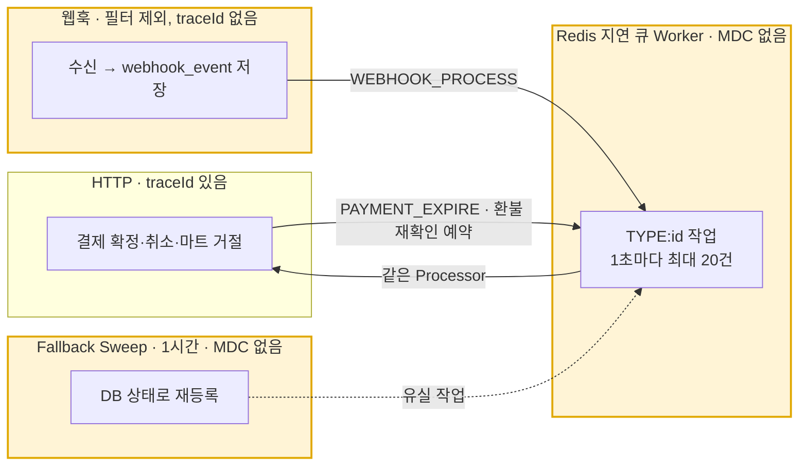

# 결제 추적성 개선 도입 검토

작성일 2026-11-04. 기준 `dev` `9172f6d`.

결제 한 건을 API 요청 밖(웹훅, Redis 지연 큐 Worker, Fallback Sweep, 스케줄러)까지 따라가려면 어떤 키로 잇고 무엇을 더해야 하는지 정리한다. 요청 로그, 추적 ID, actuator, Prometheus·Grafana 구성은 `docs/monitoring.md`에 있으므로 여기서는 다시 적지 않는다.

## 1. 배경과 문제

### 현재 추적 가능한 것

- **HTTP 요청**: `RequestLoggingFilter`가 요청마다 UUID를 MDC `traceId`와 응답 헤더 `X-Request-Id`로 넣고 요청 로그 한 줄을 남긴다. 단 `/api/webhooks`와 `/api/webhooks/**`는 `shouldNotFilter`로 제외되어 웹훅 요청에는 `traceId`도 요청 로그도 없다.
- **API 밖의 실행**: 지연 큐 Worker, Fallback Sweep, 멤버십·빌링키·포인트 스케줄러는 스레드에 MDC 값이 없다. 결제 흐름 전체가 하나의 요청 ID를 공유하지 않으며, 웹훅과 큐 작업의 로그는 메시지에 적힌 도메인 ID로만 찾을 수 있다.
- **결제 로그**: payment 도메인 로그 문장은 246개다(ERROR 92, WARN 84, INFO 69, DEBUG 1). PortOne 클라이언트(`infra/portone`)가 42개를 더 남긴다. "운영 확인", "수동 확인", "운영 정합화"를 담은 줄이 49개이고 그중 39개가 ERROR다. 집계 기준: `src/main/java/com/recipick/domain/payment` 아래에서 `grep -rEo 'log\.(error|warn|info|debug|trace)\('`로 로그 호출을 세고(레벨별은 같은 패턴을 레벨마다), 문구는 `grep -rhE '운영 확인|수동 확인|운영 정합화' … | grep -cE 'log\.'`로 로그 호출 줄만 셌다. PortOne 클라이언트는 `src/main/java/com/recipick/infra/portone`에 같은 패턴을 썼다
- **결제 지표**: 결제 전용 지표는 없다. PortOne RestClient 3개(`portOneRestClient`, `portOneMembershipRefundRestClient`, `billingKeyDeletionRestClient`)는 `RestClient.builder()` 정적 빌더로 만들어 `http.client.requests`에도 잡히지 않는다. 결제 API와 웹훅 엔드포인트의 HTTP 서버 지표만 `http.server.requests`로 수집된다.
- **운영 로그 보관**: 앱 컨테이너는 Docker `json-file`(`max-size 10m`, `max-file 3`)이고 수집기는 없다.

로그 메시지에 남는 식별자 키는 다음과 같다. 같은 이름이 다른 값을 가리키는 경우가 있다.

| 키 | payment 로그 수 | 가리키는 값 |
| --- | --- | --- |
| `refundId` | 86 | 상품 환불은 `refund.id`, 멤버십 환불은 `membership_refund.id` |
| `attemptId` | 55 | `membership_payment_attempt.id` |
| `paymentId` | 43 | `payment.id`. PortOne 클라이언트 로그 24줄의 `paymentId`는 PortOne 결제 ID 문자열이다 |
| `membershipPaymentId` | 40 | `membership_payment.id`(회차) |
| `webhookEventId` | 16 | `webhook_event.id` |
| `orderId` | 14 | 주문 ID |
| `webhookId` | 7 | PortOne 웹훅 헤더 값. 수신 실패·중복일 때만 남는다 |
| `portonePaymentId` | 1 | PortOne 결제 ID. 웹훅 MANUAL_REVIEW 한 줄에만 있다 |

식별자 키가 없는 payment 로그는 12줄이고, PortOne 클라이언트 로그는 42줄 중 18줄이 식별자 없이 남는다. 빌링키 조회·정합화 로그는 원문을 남기지 않으려고 아무 키도 남기지 않는데 스케줄러 스레드에서 돌아 `traceId`도 없다.

### 키를 잇는 방법

결제를 잇는 값은 DB에 이미 있다. 로그가 끊기는 곳은 이 관계를 따라 DB에서 이어 붙인다.

| 출발 | 이어지는 값 | 근거 |
| --- | --- | --- |
| `orderId` | `payment.id` | `payment.order_id` UNIQUE, 1:1 |
| `payment.id` | `portonePaymentId`(`pay_` + UUID) | `payment.portone_payment_id` UNIQUE |
| `portonePaymentId` | `webhook_event.id` | `webhook_event.portone_payment_id`, 인덱스 `(portone_payment_id, status)` |
| `payment.id` | `refund.id` | `refund.payment_id` FK |
| `attemptId` | `portonePaymentId`(`mpay_` 접두어) | `membership_payment_attempt.portone_payment_id` UNIQUE. 웹훅은 이 접두어로 멤버십 분기로 간다 |
| `attemptId` | `membershipPaymentId`, `membership_refund.id` | `membership_payment_attempt.membership_payment_id`, `membership_refund.membership_payment_attempt_id` |
| 큐 작업 `TYPE:id` | 위 PK 중 하나 | `WEBHOOK_PROCESS`는 `webhook_event.id`, `REFUND_RECONCILE`·`SYSTEM_REFUND_EXECUTE`·`ADMIN_REFUND_EXECUTE`는 `refund.id`, `PAYMENT_EXPIRE`는 `payment.id`, `MEMBERSHIP_REFUND_EXECUTE`는 `membership_refund.id` |

외부(PortOne, 웹훅)와 우리 DB, PortOne 클라이언트 로그에 모두 나타나는 값은 `portonePaymentId` 하나다. 생성형 요청 ID는 웹훅(PortOne이 보낸 요청), 큐 작업(`TYPE:id`만 들고 다님), 스케줄러(요청 없이 시작)로 전달되지 않으므로 결제 전체를 잇는 키가 될 수 없다.

### 운영자가 확인해야 할 대상과 지금 찾는 방법

| 대상 | 상태가 남는 곳 | 지금 찾는 방법 |
| --- | --- | --- |
| 웹훅 MANUAL_REVIEW | `webhook_event.status`, `failure_reason` | 관리자 API 없음. DB에서 `status = 'MANUAL_REVIEW'` 조회. ERROR 로그 한 줄 |
| 처리되지 않은 웹훅 | `webhook_event.status`가 RECEIVED, RETRY_PENDING, PROCESSING | DB 조회. Fallback Sweep이 1시간마다 다시 넣고 건수 합계만 WARN으로 남긴다 |
| 상품 환불 미확정(MANUAL_REVIEW, STALLED 포함) | 환불 행은 REQUESTED 그대로. 판정은 상태로 남지 않는다 | `refund.status = 'REQUESTED'`이고 `requested_at`이 3시간 이상 지난 행을 DB에서 고른다. 사유는 ERROR 로그에만 있다. 관리자 결제 상세의 환불 이력으로도 보인다 |
| 결제 만료 미확정 | 결제 행은 IN_PROGRESS 그대로 | 관리자 결제 목록 `status=IN_PROGRESS`, 또는 `expires_at`이 10분 이상 지난 행. 사유는 ERROR 로그에만 있다 |
| 멤버십 시도 UNKNOWN, MANUAL_REVIEW | `membership_payment_attempt.status`, `ops_review_required_at`, `ops_review_reason` | `GET /api/admin/membership-payment-attempts`의 `status`, `opsReviewOnly`, `blockedOnly` 필터, 상세, `POST .../{attemptId}/recheck` |
| 멤버십 환불 미확정·운영 확인 | `membership_refund.status`, `ops_review_required_at`, `ops_review_reason` | 시도 상세의 환불 목록, `POST /api/admin/membership-refunds/{refundId}/recheck`, `/retry` |
| 빌링키 삭제 확인 필요 | `billing_key_deletion.status = 'REVIEW_REQUIRED'`, `last_code` | 관리자 API 없음. DB 조회 |

관리자 조회·재조회·재시도는 `admin_audit_log`에 남는다(`MEMBERSHIP_PAYMENT_RECHECK`, `MEMBERSHIP_REFUND_RECHECK`, `MEMBERSHIP_REFUND_RETRY` 등). 이 테이블에는 `traceId`가 없어 대상 ID와 시각으로 처리 로그와 맞춘다. `AdminAuditAction.REFUND_RETRY`는 정의만 있고 쓰는 곳이 없다.

### 알 수 없는 것

| 상황 | 지금 보이는 것 | 알 수 없는 것 |
| --- | --- | --- |
| 확정 API, 웹훅, 만료 작업이 같은 결제에 겹침 | 웹훅 경로만 `웹훅 결제 확정 판정: orderId, outcome` INFO. 확정 API의 APPROVED, PG_FAILED는 결제 로그가 없다 | 어느 경로가 반영했는지. 웹훅 판정 줄에는 `webhookEventId`가 없다 |
| 지연 큐 작업 | 예외일 때만 ERROR `task=TYPE:id`. 정상 처리는 DEBUG라 기본 INFO에서 출력되지 않는다 | 큐 적체, 실행 예정 시각 대비 지연 |
| PortOne 호출 실패 | PortOne 결제 ID만 있는 WARN, 빌링키 조회는 식별자 없는 WARN | 어느 `payment.id`, `attemptId`의 호출인지, 호출 시간 |
| 운영 확인 발생 | ERROR 한 줄 | 발생 추이, 알림 |

## 2. 도입 기술과 각각이 해결하는 것

아래는 모두 제안이며 아직 구현되지 않았다.

| 기술 | 해결하는 문제 | 바뀌는 것 | 판단 |
| --- | --- | --- | --- |
| MDC 실행 키 `job`, `task`, `webhookId` | API 밖의 로그에 실행 구분이 없다 | `@Scheduled` 메서드 11개, `PaymentDelayQueueWorker.run`, `PortOneWebhookFacade.receive` | 지금 도입 |
| MDC 결제 키 | 로그를 결제 단위로 모을 수 없다 | 상태를 바꾸는 Facade 진입점과 `MembershipChargeExecutor` | 지금 도입 |
| 로그 키 이름 정리 | `paymentId`, `refundId`가 서로 다른 값을 가리킨다 | `infra/portone` 로그의 `paymentId=`를 `portonePaymentId=`로. 멤버십 환불 MDC 키는 `membershipRefundId` | 지금 도입 |
| 결과 Counter와 큐 Gauge | 운영 확인 발생과 큐 지연을 수치로 볼 수 없다 | 측정 지점 5곳. 의존성 추가 없음 | 다음 단계 |
| PortOne RestClient 계측 | 외부 호출 시간을 모른다 | 빌더에 `observationRegistry` | 다음 단계 |

## 3. 적용 설계

### MDC 키

| 키 | 넣는 자리 |
| --- | --- |
| `job` | `PaymentScheduledTasks`, `MembershipBillingScheduledTasks`, `BillingKeyDeletionScheduledTasks`, `PointExpirationScheduler`의 `@Scheduled` 메서드 |
| `task` | `PaymentDelayQueueWorker.run`. 값은 `task.member()` |
| `webhookId` | `PortOneWebhookFacade.receive` 첫 줄 |
| `webhookEventId` | `PaymentReconciliationFacade.processWebhook` |
| `orderId`, `paymentId`, `portonePaymentId` | `PaymentConfirmFacade.confirm`, `PaymentCancelFacade.cancel`, `MartRejectionFacade.reject`, `PaymentExpirationFacade.execute`. 웹훅은 결제를 찾은 직후 |
| `refundId` | `RefundReconciliationFacade.reconcile`, `SystemRefundExecutionFacade.execute`, `AdminRefundExecutionFacade.execute` |
| `attemptId`, `portonePaymentId` | `MembershipChargeExecutor.execute`, `reconcile`. 구독 API, 체험 전환, 갱신, 복구, 웹훅, 관리자 재조회가 모두 지난다 |
| `membershipRefundId` | `MembershipRefundExecutionFacade.execute`, `recheck` |

`MartRejectionFacade.reject`가 `AdminRefundExecutionFacade.execute`를, `MembershipRefundAdminFacade`가 `MembershipRefundExecutionFacade.execute`를 부르는 중첩이 있다. `MDC.putCloseable`은 닫을 때 키를 지워 바깥 값까지 사라지므로, 이전 값을 되돌리는 작은 scope 헬퍼를 쓴다. 결제 도메인에는 `@Async`나 별도 실행기가 없어 MDC 전파 설정은 필요 없다. 로컬 콘솔은 `logging.pattern.correlation`에 `traceId`, `task`, `job`만 넣고, 결제 키는 운영 JSON 필드로 본다.

### 지표

| 지표 | 위치 | 태그 |
| --- | --- | --- |
| `recipick.payment.confirm` | 확정 API, 웹훅, 만료 작업이 `PaymentConfirmProcessor.process`를 부른 뒤 | `source`: api, webhook, expiration. `outcome`: `PaymentApprovalOutcome` |
| `recipick.payment.review` | 지금 운영 확인 ERROR를 남기는 판정 지점 | `flow`: webhook, refund, system_refund, admin_refund, expiration, membership_charge, membership_refund. `kind`: manual_review, stalled, blocked |
| `recipick.payment.fallback.requeued` | `PaymentFallbackScheduler.sweep`이 이미 센 다섯 건수 | `kind`: 다섯 종류 |
| `recipick.payment.delay_queue.overdue_seconds` | 수집 시 `payment:delay-queue`의 가장 이른 score | 없음 |
| `recipick.membership.charge` | `MembershipChargeExecutor.execute`, `reconcile` 반환 뒤 | `trigger`, `outcome`: `MembershipChargeOutcome` |

`popDue` Lua 스크립트는 member만 돌려주고 score를 버려서 Worker가 지연을 직접 잴 수 없다. 그래서 큐 지연은 수집 시점에 ZSET을 읽는 Gauge로 둔다. 상품 환불·만료의 MANUAL_REVIEW는 상태로 남지 않아 Fallback이 다시 넣으면 같은 판정이 반복되므로, `payment.review`는 건수가 아니라 판정 횟수다. 미해결 건수는 1절의 DB 조회로 본다. 기록은 롤백된 판정을 세지 않도록 Processor 안이 아니라 커밋 뒤 호출한 쪽에서 하고, 드문 조합은 `AiRequestMetrics`처럼 0으로 미리 등록한다.

### 민감 정보와 카디널리티 규칙

- 빌링키, 발급 요청 ID, 토큰, 카드 정보는 메시지, MDC, 태그 어디에도 넣지 않는다. 빌링키는 `billingKeyId`(PK)만 쓴다. 기존 `BillingKeyLogMaskingFilter`(Logback TurboFilter)는 `uk_billing_key_portone_billing_key`, `uk_billing_key_issue_request_issue_id` 위반 메시지가 담긴 줄을 appender 앞에서 막는다. 새 MDC 키는 이 필터와 겹치지 않는다.
- `orderId`, `paymentId`, `attemptId`, `portonePaymentId`, `memberId`는 지표 태그로 쓰지 않는다. 태그는 enum과 고정 문자열만 쓴다.
- PortOne RestClient를 계측할 때 `uri` 태그는 템플릿이어야 한다. 결제 조회·취소와 빌링키 청구·조회는 `.uri("/payments/{paymentId}", id)` 형태라 템플릿이 남는다. `PortOneBillingKeyDeletionClient`는 빌링키를 펼친 `URI` 객체를 넘기므로 템플릿이 없다. Spring 기본 규약은 이때 `uri`를 `none`으로 기록하는 것으로 알고 있으나 확인 필요하다. 추적 백엔드를 붙이면 span의 URL에 원문이 남으므로 그때는 이 클라이언트를 계측에서 뺀다.

## 4. 대용량 처리로 갔을 때의 이점

- Worker는 1초마다 최대 20건을 꺼내 PortOne을 동기 호출하고, Fallback Sweep과 같은 `taskScheduler` 스레드 하나를 쓴다. 큐 지연 Gauge가 있어야 배치 크기, 스케줄러 분리, 증설 중 무엇이 필요한지 판단할 수 있다.
- 인스턴스가 늘면 한 결제의 확정 API, 웹훅, 만료 작업이 다른 서버에서 돈다. 수집기에서 `portonePaymentId` 필드로 찾는 방식이 남으므로 지금 MDC 키를 정해 두면 그때 코드를 다시 고치지 않는다.
- `payment.confirm`의 AMOUNT_MISMATCH, EXPIRED, ALREADY_CLOSED와 `payment.review`는 돈이 PG에 남거나 사람이 봐야 하는 경우라, 회전되는 로그를 뒤지기 전에 알림으로 바꿀 수 있다.

## 5. 하지 않는 것

- **결제 흐름 전체에 요청 ID 하나를 전파.** 웹훅, 큐, 스케줄러에는 전달 경로가 없다. 도메인 키로 잇는다.
- **웹훅을 `RequestLoggingFilter`에 다시 포함.** 웹훅은 현재 공통 요청 로깅 필터에서 제외한다. 이 필터는 요청 본문을 읽거나 바꾸지 않으므로 서명 검증과는 관계없다. 웹훅 처리 추적은 도메인 로그와 DB 이벤트 ID(`webhook_event.id`)로 하고, 앞으로 `webhookId` MDC를 더한다.
- **상품 환불·만료 MANUAL_REVIEW의 상태 컬럼 추가.** 도메인 설계 변경이라 이 문서 범위가 아니다.
- **Micrometer Tracing.** 추적 백엔드가 없다.
- **도메인 ID 태그, 상태 전이마다 로그.**

## 6. 성공 기준과 측정 계획

기준은 "임의 결제 하나를 `portonePaymentId`로 검색해 확정 API, 웹훅, 큐 작업, Fallback 재등록까지 시간순으로 재현할 수 있다"이다.

| 기준 | 측정 방법 |
| --- | --- |
| 상품 결제 재현 | 한 결제에 확정 API, 웹훅, 만료 작업을 겹쳐 보내고 `portonePaymentId` 검색으로 세 경로가 `traceId`, `webhookId`, `task`로 구분되는지 확인 |
| 멤버십 시도 재현 | 임의 `attemptId`로 청구, PortOne WARN, 웹훅 재조회, 복구 로그가 함께 나오는지 확인 |
| 실행 키 누락 없음 | Worker와 스케줄러 로그에 `task` 또는 `job`이 빠진 줄이 없는지 확인 |
| 운영 확인 감지 | 부분 취소 웹훅 등으로 MANUAL_REVIEW를 만들고 `recipick.payment.review`가 Prometheus에 나타나는지 확인 |
| 민감 정보 없음 | 빌링키 등록·삭제 테스트의 로그와 `/actuator/prometheus` 출력에 빌링키 원문이 없는지 확인 |

- [ ] `docs/convention.md`에 MDC 키 목록과 헬퍼 위치 추가
- [ ] scope 헬퍼, `job`, `task`, `webhookId` 넣기
- [ ] 결제 Facade와 `MembershipChargeExecutor`, `MembershipRefundExecutionFacade`에 결제 키 넣기
- [ ] PortOne 클라이언트 `paymentId=`를 `portonePaymentId=`로 정리
- [ ] 지표 5종과 PortOne RestClient 계측, `uri` 태그 확인
- [ ] 운영 로그 수집기 결정 후 보관 기간 기록
