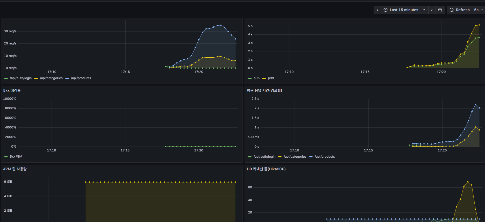
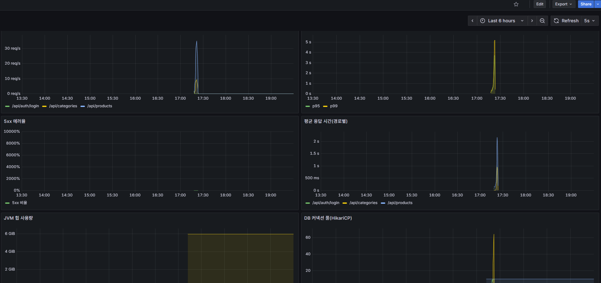

# 부하 테스트 (Before)

## 1. 상황

- 필수 8(부하 테스트)과 이후 병목 개선(필수 9)·캐싱(필수 10)은 모두 **같은 조건에서 잰 Before → After 수치**로 평가한다.
- 상품 검색(`GET /api/products`)은 회원 전용이고, 이름 포함 검색(`LIKE '%키워드%'`)과 카테고리·가격 필터, 정렬을 조합하는 가장 무거운 조회라서 부하 테스트의 중심으로 삼았다.
- 상품 검색은 로그인한 회원의 `mart_id`로 마트를 정하므로, 마트가 배정된 테스트 회원이 필요하다.

## 2. 후보와 선택

### 도구

| 후보 | 장점 | 단점 |
| --- | --- | --- |
| JMeter | 화면(GUI)으로 시나리오 작성, 사용 사례가 많음 | 시나리오가 XML이라 코드 리뷰·변경 이력 관리가 어렵고 무거움 |
| Gatling | 코드로 시나리오 작성, 리포트가 좋음 | Scala/Java DSL 학습 비용, 별도 빌드 구성이 필요 |
| **k6(선택)** | 시나리오가 JS 한 파일이라 짧고 리뷰하기 쉬움, 단계별 부하·API별 결과 분리·합격선 지정이 쉬움, Docker 이미지로 설치 없이 실행 | JS 런타임이라 JVM 라이브러리를 쓸 수 없음 |


- k6를 Docker 이미지(`grafana/k6`)로 실행한다. 팀원은 설치 없이 같은 명령으로 같은 시나리오를 재현할 수 있다.

### 로그인 방식

- 로그인(BCrypt)은 한 번에 수십~수백 ms가 걸린다. 요청마다 로그인하면 상품 검색이 아니라 로그인 성능을 재게 된다.
- 그래서 k6의 `setup()`에서 회원마다 한 번만 로그인하고, 이후에는 토큰(유효 30분)을 재사용한다.

### 테스트 회원

- `scripts/perf/seed-members.sql`로 성능 회원 100명(`perf-user-001~100@recipick.test`)을 한 번에 만든다. 같은 BCrypt 해시와 `mart_id=1`(삼청 마트)을 직접 넣는다.
- 가입 API를 100번 호출하는 것보다 빠르고 매번 같은 계정이 만들어진다. 재실행하면 기존 성능 회원을 지우고 다시 만든다(멱등).
- 비밀번호는 로컬 성능 테스트 전용 값이며 실서비스 값이 아니다.

## 3. 시나리오

스크립트: `scripts/perf/k6/product-search.js`

| 요청 | 비율 | 설명 |
| --- | --- | --- |
| 키워드 검색 | 50% | `keyword=`(대파·유기농·양파·두부·소고기 중 무작위), 20건 |
| 필터 검색 | 30% | 카테고리(1~20 무작위) + 가격 1,000~20,000원 + 가격 낮은 순 |
| 카테고리 조회 | 20% | `GET /api/categories`(가벼운 API 비교용, 공개 API) |

- 각 가상 사용자(VU)는 요청 후 1초 쉬고 반복한다(실제 사용자 흉내).
- 부하 단계: 10명 → 50명 → 100명, 각 단계마다 올리는 30초와 유지하는 1분, 마지막 20초 감소. 총 약 4분 50초.
- 데이터는 `docs/performance/seed-data.md`의 시드(마트당 상품 5만 건)를 쓴다.
- 합격선(threshold)은 `p95 < 1초`, 실패율 `< 1%`이다. 이 값은 합격 판정이 아니라 **Before/After 비교용 기준선**이며, 넘겨도 측정은 끝까지 진행되고 결과가 남는다.

## 4. 실행 방법

1. `docker compose up -d`로 MySQL·Redis를 띄운다(`.env`의 `MYSQL_DATABASE=recipick_perf`, 시드 데이터는 `seed-data.md` 참고).
2. 앱을 한 번 실행해 테이블을 만들고, 레포 루트에서 Git Bash로 테스트 회원을 만든다.
   ```bash
   docker exec -i recipick-mysql sh -c 'mysql -uroot -p"$MYSQL_ROOT_PASSWORD" --default-character-set=utf8mb4 recipick_perf' < scripts/perf/seed-members.sql
   ```
3. 앱을 `local` 프로필로 실행한다(앱 포트 8080, 관리 포트 8081).
4. (선택) `docker compose -f docker-compose.monitoring.yml up -d`로 Grafana 대시보드를 함께 본다.
5. 부하를 실행한다(약 5분). Git Bash에서 실행하고, 맨 앞의 `MSYS_NO_PATHCONV=1`은 Git Bash가 `/scripts` 경로를 윈도우 경로로 바꾸지 않게 한다.
   ```bash
   MSYS_NO_PATHCONV=1 docker run --rm -i -v "$(pwd -W)/scripts/perf/k6:/scripts:ro" grafana/k6:1.3.0 run /scripts/product-search.js
   ```
   앱 포트가 다르면 `-e BASE_URL=http://host.docker.internal:포트`를 추가한다.

## 5. Before 결과 (2026-10-27, 로컬)

After와 같은 조건(앱, MySQL, Prometheus, Grafana를 모두 켠 상태)에서 잰 **2회차 측정**을 Before 기준값으로 쓴다. 모니터링 없이 잰 1회차는 참고용으로 아래에 함께 적는다.

| 항목 | 2회차 (Before 기준, 모니터링 켬) | 1회차 (참고, 모니터링 끔) |
| --- | --- | --- |
| 총 요청 수 | 8,069 (로그인 100건 포함) | 8,915 |
| 처리량 | 약 26.9 요청/초 | 약 29.8 요청/초 |
| 실패율 | 0% | 0% |
| 평균 응답 시간 | 741ms | 575ms |
| 중앙값 | 376ms | 373ms |
| p90 / p95 / p99 | 2.05s / 2.66s / 3.71s | 1.38s / 1.47s / - |
| 최대 | 6.27s | 2.66s |

API별 응답 시간 (2회차)

| 요청 | 평균 | 중앙값 | p95 | p99 | 기준(p95 1초) |
| --- | --- | --- | --- | --- | --- |
| 키워드 검색 | 985ms | 499ms | 2.93s | 3.88s | 초과 |
| 필터 검색 | 646ms | 150ms | 2.48s | 3.42s | 초과 |
| 카테고리 조회 | 319ms | 59ms | 1.27s | 2.03s | 초과 |

DB 커넥션 풀(HikariCP, Prometheus 기록, 측정 구간 최대값)

| 지표 | 값 |
| --- | --- |
| 풀 최대 크기(max) | 10 |
| 사용 중 연결(active) | 10 (풀이 가득 참) |
| 연결을 기다린 요청(pending) | 최대 69 |
| 연결 대기 타임아웃 | 0건 |




두 회차의 차이(p95 1.47s와 2.66s)가 크다. 같은 PC에서 돌리면 다른 프로그램과 모니터링 도구가 자원을 나눠 쓰기 때문이다. 그래서 After도 모니터링을 켠 같은 조건에서 재고, 가능하면 3회 측정해 중앙값을 쓴다.

## 6. 해석

- 100명이 동시에 접속하는 구간에서 **커넥션 풀이 가득 찼다.** 풀은 10개인데 연결을 기다린 요청이 최대 69개까지 쌓였다. 에러는 없지만(타임아웃 0건) 요청이 줄을 서서 응답이 느려졌다고 볼 수 있다.
- 풀이 가득 찬 이유는 **쿼리 하나가 연결을 오래 쥐고 있기 때문**일 가능성이 크다. 이 경우 풀 크기만 키우면 DB 부담만 늘 수 있어서, 먼저 쿼리를 빠르게 만든다. 이것은 가설이며 **4단계에서 `EXPLAIN`으로 확인한다.**
- 가장 느린 것은 키워드 검색이다. 이름 포함 검색(`LIKE '%키워드%'`)은 앞부분이 고정되지 않아 일반 인덱스를 쓰기 어렵다는 가설을 세웠다.
- 필터 검색도 p95가 1초를 넘는다. 카테고리·가격 조건과 정렬을 지원하는 인덱스가 없는 것이 원인 후보이다(`PRODUCT`에는 `(mart_id, ingredient_id)` 인덱스만 있다).
- 카테고리 조회는 가벼운 API인데도 p95가 1.27s다. 상품 검색이 연결을 다 쓰고 있어서 같이 기다린 것으로 보인다. 상품 검색 쿼리가 빨라지면 함께 좋아지는지 After에서 확인한다.
- 이 단계의 개선 목표(After)는 키워드·필터 검색 p95를 줄이고 같은 부하에서 처리량을 높이며 pending을 줄이는 것이다. 목표 수치는 병목 원인을 확인한 뒤 정한다.

## 7. 한계

- **로컬 단일 PC 측정**이다. 앱, MySQL, k6와 개발 도구(IntelliJ, 슬랙, 브라우저)가 한 컴퓨터의 CPU와 메모리를 함께 쓴다. 가벼운 카테고리 조회의 p95가 735ms로 높은 것도 이 영향이 크다. 절대값이 아니라 **같은 조건에서의 Before/After 비교**에 의미가 있다.
- 서버(AWS)가 확정되면 같은 시나리오로 다시 측정한다.
- 측정이 2회뿐이고 값이 흔들렸다. After를 잴 때는 같은 환경(켜 둔 프로그램 포함)에서 3회 재서 중앙값을 쓴다.
- 요청 총 수에 `setup()` 로그인 100건이 들어 있다(검사 8,815건이 시나리오 요청).
- 시나리오는 상품 검색 중심이다. 주문·장바구니·결제 등 쓰기 API 부하는 측정하지 않았다.
- 시드 데이터가 인위적이라(`seed-data.md` 한계 참고) 실제 검색어 분포와 다르다.
