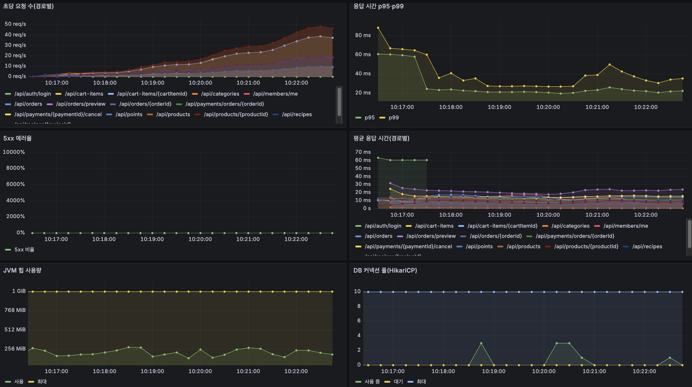

# 로컬 최대 100명 혼합 부하 검증

| 항목 | 내용 |
| --- | --- |
| 담당·일자 | 채빈, 2026-11-03 |
| 앱 기준 | `bbd0943` JAR. 이후 dev 변경까지 검증한 결과는 아님 |
| 계측 기준 | `feature/perf-failure-diagnostics` 작업본. 실패 진단·지표 수집 보강 후 실행 |
| 목적 | 사용자 흐름의 지연·실패·종료 정합성 확인. 성능 개선 Before/After 비교가 아님 |
| 근거 | [측정 요약 JSON](results/local-native-100-2026-11-03.json), [타임아웃 분석](../troubleshooting/k6-docker-host-timeout.md) |

## 1. 환경·시나리오

Mac16,12(CPU 10, RAM 16GiB), Java 17.0.19, MySQL 8.4, Redis 7.4, k6 1.3.0 macOS arm64. 앱·DB·부하 도구와 기존 개발 프로세스가 한 PC 자원을 공유한다. 성능 전용 DB와 Redis를 사용해 개발 데이터와 분리했다. JVM은 Xms256m/Xmx1024m, Hikari 최대 10, Redis 캐시는 기본 ON, 호출 제한은 성능 앱에서만 OFF다. 실제 PG 주소 대신 연결 불가한 로컬 주소를 설정했고 PG 호출이 필요한 결제는 실행하지 않았다.

회원 100명, 상품 100,660건(시연 660 + 성능 100,000), 레시피 100개다. 쓰기 상품 100개를 회원별로 분산했다. [성능 시드](seed-data.md)의 생성 규칙을 사용하며 상품 수·비율은 측정 가정이다.

1명 mixed 점검(41개 확인 모두 성공) 후 `10 → 30 → 60 → 100 VU`로 늘려 약 6분20초를 실행했다. 각 단계의 상승 30초·유지 1분, 마지막 감소 20초이며 setup은 별도 약 9초다. 최대 100 VU는 초당 100요청을 뜻하지 않는다. 흐름마다 1초 대기하며 로그인은 setup에서만 수행한다.

| 흐름 | 반복 횟수 기준 비율 | 내용 |
| --- | --- | --- |
| 상품 | 50% | 검색·상세·카테고리 |
| 레시피 | 20% | 목록·상세 |
| 회원 | 10% | 내 정보·주문 목록·포인트 |
| 장바구니 | 10% | 담기·수량 수정·조회·삭제 |
| 주문 | 10% | 장바구니·미리보기·생성·결제 전 취소·종료 확인·정리 |

HTTP 요청 수 비율은 위 비율과 다르다. 실제 결제 성공·PG 환불·배송·AI·관리자·가입/탈퇴·로그인 부하는 포함하지 않는다. 재현 절차는 [부하 실행 안내](load-test.md#macos에서-docker-경로와-호스트-실행을-구분하는-점검)를 따른다. 호스트 k6는 `localhost`, Docker k6는 `host.docker.internal`을 사용한다.

## 2. 결과와 API별 지연

총 요청 58,199건, 실패 0건, 완료 흐름 16,408회, 평균 149.41요청/초(setup 포함)다. 시나리오 요청 p95 72.45ms, p99 193.05ms, 최대 770.75ms다. JSON 값을 반올림했으며 콘솔의 표시 정밀도와 소수점 끝자리가 다를 수 있다.

| 클라이언트 k6 지표 | p95(ms) | p99(ms) | 최대(ms) |
| --- | --- | --- | --- |
| 상품 검색 | 80.79 | 185.29 | 461.30 |
| 레시피 목록 | 69.92 | 165.79 | 370.96 |
| 전체 시나리오 요청(setup 제외) | 72.45 | 193.05 | 770.75 |

다음은 Prometheus 전후 히스토그램 차이로 계산한 **서버 계측**이다. 연결·클라이언트 대기 시간은 포함하지 않고 setup을 포함한다. p95/p99는 해당 누적 비율을 처음 넘는 버킷의 상한이며 실제 백분위값이나 클라이언트 지연으로 대체하지 않는다. 표시 상한은 소수 둘째 자리까지 올림했다. 요청 수 합계는 k6 총 요청 수와 일치한다.

| API | 요청 수 | 평균 서버 ms | p95 버킷 상한 ms | p99 버킷 상한 ms |
| --- | ---: | ---: | ---: | ---: |
| `DELETE /api/cart-items/{cartItemId}` | 3,293 | 15.13 | ≤ 61.52 | ≤ 178.96 |
| `GET /api/cart-items` | 3,393 | 19.36 | ≤ 89.48 | ≤ 178.96 |
| `GET /api/categories` | 8,209 | 1.21 | ≤ 4.20 | ≤ 8.39 |
| `GET /api/members/me` | 1,738 | 20.52 | ≤ 67.11 | ≤ 178.96 |
| `GET /api/orders` | 1,738 | 17.72 | ≤ 61.52 | ≤ 156.59 |
| `GET /api/orders/{orderId}` | 1,650 | 14.75 | ≤ 67.11 | ≤ 178.96 |
| `GET /api/payments/orders/{orderId}` | 1,650 | 25.64 | ≤ 111.85 | ≤ 357.92 |
| `GET /api/points` | 1,638 | 15.84 | ≤ 55.93 | ≤ 156.59 |
| `GET /api/products` | 8,309 | 19.35 | ≤ 89.48 | ≤ 201.33 |
| `GET /api/products/{productId}` | 8,309 | 16.96 | ≤ 67.11 | ≤ 178.96 |
| `GET /api/recipes` | 3,368 | 19.96 | ≤ 89.48 | ≤ 178.96 |
| `GET /api/recipes/{recipeId}` | 3,268 | 18.36 | ≤ 67.11 | ≤ 178.96 |
| `PATCH /api/cart-items/{cartItemId}` | 3,293 | 21.76 | ≤ 89.48 | ≤ 201.33 |
| `POST /api/auth/login` | 100 | 65.54 | ≤ 89.48 | ≤ 89.48 |
| `POST /api/cart-items` | 3,293 | 25.63 | ≤ 111.85 | ≤ 246.07 |
| `POST /api/orders` | 1,650 | 35.88 | ≤ 156.59 | ≤ 357.92 |
| `POST /api/orders/preview` | 1,650 | 50.77 | ≤ 223.70 | ≤ 536.88 |
| `POST /api/payments/{paymentId}/cancel` | 1,650 | 30.88 | ≤ 156.59 | ≤ 357.92 |

이번 비교선인 p95 1초 미만·실패율 1% 미만 및 차단/정리 실패/쓰기 건너뜀 0을 모두 충족했다. 가장 높은 서버 p99 상한은 주문 미리보기 약 537ms다. 현재 결과만으로 즉시 쿼리·인덱스·연결 풀을 변경할 근거는 없다. 이 값들은 전체 ramp 구간이며 100명 유지 구간만의 결과가 아니다.

5초 샘플에서 앱 CPU 지표 최대 약 15.8%, 시스템 CPU 지표 최대 100%, DB 연결 대기 최대 16, Tomcat busy 최대 26이 관측됐다. DB 연결 획득 타임아웃은 0이었다. 시스템 CPU와 DB 대기 관측은 공유 PC의 자원 경합 가능성을 보여주므로 운영 병목이나 지속 부하로 단정하지 않는다. 5초 사이 순간 최대값은 알 수 없고 이번 측정은 단일 회차다.

## 3. 실패 처리와 정합성

앞선 Docker 진단 실행은 타임아웃 5건·장바구니 정리 실패 1건·쓰기 건너뜀 23회로 **실패 판정**을 유지한다. 호스트 실행이 성공했다고 이전 실패를 삭제하거나 애플리케이션 버그를 해결한 것으로 해석하지 않는다. 연결 경로 비교와 제한은 [트러블슈팅](../troubleshooting/k6-docker-host-timeout.md)에 정리했다.

호스트 실행 종료 후 smoke 포함 주문 1,651건은 모두 CANCELED, 결제 1,651건은 FAILED/CANCELED_BEFORE_PAY, 적립 예정 1,651건은 CANCELED였다. 장바구니·미종료 주문·PENDING 적립·RESERVED 사용·포인트 잔액은 0이며 쓰기에 사용한 상품 100개의 재고가 측정 전후 일치했다. 차단 사용자·정리 실패·건너뛴 쓰기도 모두 0이다.

## 4. 사전 기능 검증과 남은 항목

`bbd0943`에서 `./gradlew test` 총 3,384건, 실패/오류 0, 실제 Claude 평가 2건 건너뜀을 확인했다. 이 중 클래스명 기준 동시성 107건, 복구·정합화·웹훅 관련 301건도 통과했다. 분류별 집계는 추가 실행 횟수가 아니다. 테스트 종료 때 공유 Testcontainers DB의 create-drop FK 정리 오류 로그가 있었으나 테스트는 통과했다. 별도 조사 항목이며 이번 타임아웃 원인과 섞지 않는다.

브라우저 회원가입·로그인·배송지·상품 담기·주문서 표시를 확인하고 로컬 API로 주문 생성→결제 전 취소→CANCELED를 확인했다. 비로그인 401·회원의 관리자 API 403·다른 회원 주문 404·카드 없는 체험 409·잘못된 탈퇴 비밀번호 400·탈퇴 스위치 비활성 503도 확인했다. 브라우저 점검 당시 실행 중인 로컬 서버를 사용했으며 서버가 최신 dev라는 근거는 없어 최신 커밋 전체 E2E 검증으로 주장하지 않는다. 점검용 가상 회원은 로컬에 남아 있다.

| 남은 검증 | 현재 상태 | 완료 조건 |
| --- | --- | --- |
| 멤버십 전체 화면 흐름 | 확인 당시 프론트는 조회 전용 | 화면 연결 후 체험·구독·해지 예약·즉시 해지와 오류/대기 상태 확인 |
| 실제 탈퇴 성공 | 연결된 화면은 있으나 스위치 OFF로 차단 | 결제·배포 담당과 활성화 준비 후 정산·카드·포인트·회원 정리·기존 토큰 차단 확인 |
| 실제 PG·HTTPS 쿠키·운영 웹훅 | 이번 로컬 점검 범위 밖 | 테스트 채널과 배포 환경에서 별도 검증. 기존 배포 검증 기록과 구분 |
| 실제 Claude 품질 | 자동 평가 2건 건너뜀 | 키·비용을 준비한 명시적 평가 |
| 운영에 가까운 성능 | 로컬 단일 PC 예비 측정만 완료 | 서버 환경·데이터·측정 범위를 고정하고 API별 결과 재확인 |

## 5. 근거 보관

버전 관리하는 [요약 JSON](results/local-native-100-2026-11-03.json)에는 선택한 k6 원본 지표·서버 API별 히스토그램 집계·정합성·샘플 최댓값과 원본 SHA-256을 남겼다. 원본은 로컬 gitignore 대상 `scripts/perf/results/local-native-100-2026-11-03/`에 JSON·로그·접근 로그·78개 지표 샘플·재고 TSV와 함께 보관한다. 클론에 원본이 자동 포함되지는 않으므로 제출 시 민감정보 검토 후 별도 첨부해야 한다. 비밀 설정·토큰·쿠키·요청/응답 본문은 버전 관리 자료에 넣지 않는다.

## 6. Grafana 연결 후 추가 측정 (2026-11-04)

한국 시간 10:16:24~10:22:53에 같은 성능 앱(`bbd0943`)과 호스트 k6로 혼합 시나리오를 실행했다. 기존 성능 전용 DB·Redis를 재사용했으며 시작 전 장바구니·미종료 주문·예약 사용·PENDING 적립이 모두 0인 것을 확인했다. 인덱스·캐시가 적용된 상태이며 Prometheus·Grafana를 추가로 실행했다. 앞선 회차와 캐시·DB·JVM 예열 상태 및 공유 PC의 부하가 같다고 보장하지 않으므로 성능 개선율을 계산하지 않는다.

| 항목 | 결과 |
| --- | ---: |
| 최대 동시 사용자 | 100 VU |
| 총 HTTP 요청(setup 포함) | 59,899건 |
| HTTP 요청 실패 | 0건 |
| 완료 흐름 | 16,921회 |
| 시나리오 요청 p95 / p99 | 22.39ms / 35.66ms |
| 시나리오 요청 최대 | 151.97ms |
| 차단 사용자·정리 실패·쓰기 건너뜀 | 모두 0 |
| 종료 정합성 | 장바구니·미종료 주문·예약 사용·PENDING 적립·포인트 잔여 0, 결제 전 취소 상태 및 재고 복원 확인 |

그래프는 5초마다 수집한 서버 지표다. 응답 시간 패널은 1분 구간의 히스토그램으로 계산한 p95·p99이므로 위 k6 전체 시나리오 백분위와 직접 일치하지 않는다. 5xx 선은 0이며 세로축 눈금 자체를 오류 발생 비율로 해석하지 않는다. DB 연결 패널의 최대 10은 풀 설정 상한이며 실제 사용 중 연결 수와 구분한다. 캡처의 구간과 해상도만으로 모든 순간의 최대값을 확정하지 않는다.

실행 구간 Prometheus 대상 `up`은 조회한 78개 시점 모두 1이었다. 이번 실행은 개선 후 상태의 혼합 흐름 검증이며 기존 [인덱스](bottleneck.md)·[캐시](caching.md) Before/After를 대체하지 않는다. [추가 측정 요약 JSON](results/local-grafana-100-2026-11-04.json)에 선택한 원본 지표·정합성·원본 체크섬을 보관한다. 원본 로그와 지표 파일은 로컬 `scripts/perf/results/grafana-100-20261104-101624/`에 보관한다.
