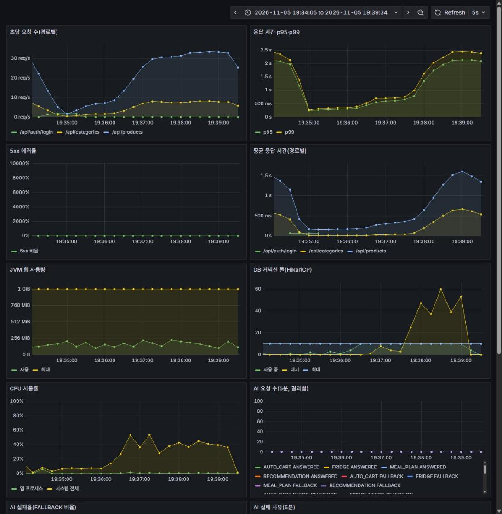
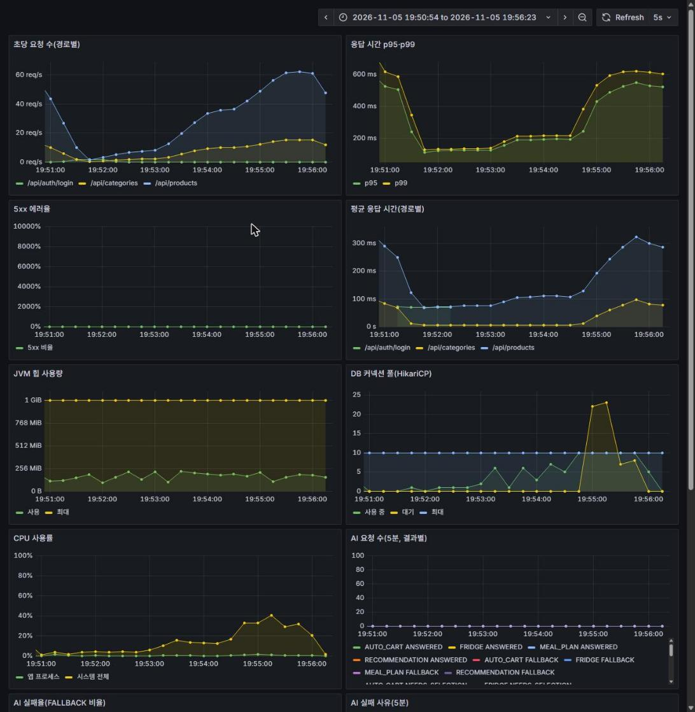

# 상품 검색 병목 개선 (인덱스)

부하 테스트 Before(`load-test.md`)에서 드러난 병목을 `EXPLAIN`으로 확인하고, 인덱스로 개선한 과정과 Before/After 결과를 기록한다.

## 1. 상황

`load-test.md`의 Before(모니터링 켠 2회차)에서 100명이 동시에 접속하는 구간에 다음이 관측되었다.

- 상품 검색 p95 2.66s, p99 3.71s, 처리량 약 26.9 요청/초
- DB 커넥션 풀(HikariCP, 최대 10개)이 가득 차고 연결을 기다리는 요청이 최대 69개

풀이 가득 찼다는 것은 쿼리 하나가 연결을 오래 쥐고 있다는 뜻일 수 있어서, 쿼리 실행 계획부터 확인했다.

## 2. 원인 분석 (`EXPLAIN ANALYZE`)

측정 조건: 로컬 MySQL, `recipick_perf` 데이터베이스, 상품 10만 건(마트 1·2에 5만 건씩), 쿼리를 단독으로 실행한 시간이다. 상품 검색 쿼리는 `ProductRepositoryImpl.searchMemberProducts`가 만든다. 한 번의 검색 요청에 목록 쿼리와 전체 개수(count) 쿼리가 각각 실행된다.

개선 전 인덱스는 `(mart_id, ingredient_id)`와 `category_id`(FK) 두 개뿐이었다.

| 쿼리 | 실행 계획(개선 전) | 시간 |
| --- | --- | --- |
| 키워드 검색 목록 | 마트 상품 5만 건을 전부 읽고 `deleted`, 이름 조건으로 거른 뒤 정렬(`filesort`) | 103ms |
| 키워드 검색 개수 | 위와 같이 5만 건을 전부 읽음 | 71ms |
| 필터 검색 목록 | `category_id` 인덱스로 5,016건을 읽고 마트·가격으로 거른 뒤 정렬(`filesort`) | 8.8ms |
| 필터 검색 개수 | 5,016건을 읽고 거름 | 7.2ms |

키워드 검색 한 번이 DB 연결을 약 175ms(103 + 71) 쥐고 있었다. 풀이 10개이면 키워드 검색만으로 초당 약 57번이 한계라서, 100명이 몰리면 줄이 생긴다는 것이 풀 대기 69개와 일치한다.

## 3. 개선: 인덱스 3개 추가

`Product` 엔티티의 `@Table(indexes)`에 추가했다.

| 인덱스 | 컬럼 | 대상 |
| --- | --- | --- |
| `idx_product_mart_category_price` | `mart_id, category_id, deleted, price, id` | 필터 검색(카테고리, 가격 범위, 가격 내림차순 정렬) |
| `idx_product_mart_category_price_asc` | `mart_id, category_id, deleted, price ASC, id DESC` | 필터 검색의 가격 오름차순 정렬 |
| `idx_product_mart_created` | `mart_id, deleted, created_at, id` | 키워드 검색과 기본 정렬(최신순) |

> `idx_product_mart_category_price_asc`는 부하 테스트 After 측정(5절) **이후에** 추가했다. 5절의 After 수치에는 포함되지 않는다.

선택 이유

- **필터 검색 인덱스**: 같음 조건(`mart_id`, `category_id`, `deleted`)을 앞에, 범위·정렬 조건(`price`)을 뒤에 둔다. 조건을 만족하는 행만 읽고, 개수 쿼리는 테이블을 읽지 않고 인덱스만으로 끝난다(covering).
- **가격 오름차순 인덱스**: 앱은 가격 오름차순을 `ORDER BY price ASC, id DESC`로 만든다. 위 필터 인덱스는 `id`가 오름차순이라 이 정렬을 그대로 쓰지 못해 `Sort`가 남았다. `id DESC`로 만든 인덱스를 따로 두면 정렬이 사라진다. 가격 내림차순(`price DESC, id DESC`)은 기존 인덱스를 거꾸로 읽어 처리하므로 둘 다 필요하다. 단독 실행에서 가격 범위가 있는 목록은 1.22ms에서 0.12ms, 카테고리 전체 목록은 5.97ms에서 0.06ms로 줄었다.
- **최신순 인덱스**: 정렬 순서와 같게 만들어 두었기 때문에 최신 상품부터 읽다가 키워드가 든 20건이 모이면 멈춘다. 정렬 작업(`filesort`)이 사라진다. 키워드가 흔할수록 효과가 크다(테스트 키워드 '대파'는 마트 안에서 약 8%).
- 기존 인덱스 `(mart_id, ingredient_id)`는 다른 기능이 쓸 수 있어 유지했다.
- 다음 방법은 이번에 쓰지 않았다. 풀텍스트(ngram) 인덱스는 개수 쿼리를 22ms까지 줄였지만 JPA가 `MATCH ... AGAINST`를 지원하지 않아 쿼리 코드 변경이 크다. 풀 크기 증가는 원인이 느린 쿼리일 때 DB 부담만 늘린다.

## 4. 개선 후 실행 계획과 시간 (단독 쿼리)

| 쿼리 | 개선 후 실행 계획 | Before | After |
| --- | --- | --- | --- |
| 키워드 검색 목록 | `idx_product_mart_created` 역순 스캔, 20건에서 중단, `filesort` 없음 | 103ms | 1.2ms |
| 키워드 검색 개수 | 변화 없음(5만 건 스캔) | 71ms | 80ms |
| 필터 검색 목록 | `idx_product_mart_category_price` 범위 스캔(451건) | 8.8ms | 1.1ms |
| 필터 검색 개수 | 같은 인덱스만으로 계산(covering) | 7.2ms | 0.24ms |

키워드 검색의 개수 쿼리는 `LIKE '%키워드%'`가 인덱스를 쓰지 못해 개선되지 않았다. 아래 7절에서 다룬다.

## 5. 부하 테스트 결과 (Before / After)

같은 시나리오(`scripts/perf/k6/product-search.js`), 같은 조건(앱, MySQL, Prometheus, Grafana를 모두 켠 상태)에서 After를 3회 측정하고 **중앙값**을 사용했다. Before는 `load-test.md`의 2회차이다.

| 항목 | Before | After 1회 | After 2회 | After 3회 | After(중앙값) |
| --- | --- | --- | --- | --- | --- |
| 처리량(요청/초) | 26.9 | 40.7 | 42.5 | 42.6 | **42.5** |
| 전체 평균 | 741ms | 148ms | 103ms | 100ms | **103ms** |
| 전체 p95 | 2.66s | 448ms | 264ms | 262ms | **264ms** |
| 전체 p99 | 3.71s | 615ms | 363ms | 344ms | **363ms** |
| 실패율 | 0% | 0% | 0% | 0% | 0% |

API별 p95

| 요청 | Before | After(중앙값) | 변화 |
| --- | --- | --- | --- |
| 키워드 검색 | 2.93s | 306ms | -90% |
| 필터 검색 | 2.48s | 135ms | -95% |
| 카테고리 조회 | 1.27s | 78ms | -94% |

전체 p95는 2.66s에서 264ms로(-90%), p99는 3.71s에서 363ms로(-90%) 줄었다.

DB 커넥션 풀(HikariCP)

| 지표 | Before | After |
| --- | --- | --- |
| 풀 최대 크기 | 10 | 10 |
| 연결을 기다린 요청(pending) 최대 | 69 | 23 |

> 처리량이 +58%에 그친 것은 시나리오가 요청마다 1초씩 쉬기(think time) 때문이다. 응답이 빨라져도 가상 사용자 100명이 보내는 요청 수에는 한계가 있어서, 개선 효과는 처리량보다 응답 시간(p95, p99)에서 잘 보인다.

### 5-1. 재측정 (2026-11-05, 최신 dev)

마지막 측정 뒤 백엔드가 바뀌어 같은 시나리오로 다시 쟀다. 재측정 조건: dev `009a2a18`의 JAR(`-Xms256m -Xmx1024m`, 포트 28080/28081)을 `recipick_perf`(상품 100,661건, 회원 100명)에 연결해 실행했다. 호출 제한은 끄고 `product-search.js`를 호스트 k6로 3회씩 돌렸다. 단계마다 앱을 새로 띄웠고(Before는 인덱스 3개를 `DROP INDEX`로 제거한 뒤 시작, 인덱스 후는 앱 기동이 인덱스를 다시 만든 상태) 캐시는 Before·인덱스 후에 `recipick.cache.enabled=false`, 캐시 후에 켰다. 회마다 캐시 키를 비우고 시작했다. 기존 개발 앱(8080)과 다른 프로그램이 같은 PC에서 켜져 있었다.

> 10월 측정과 값이 다르다. Before는 더 빨라졌고(p95 2.66s → 1.87s) After는 더 느려졌다(인덱스 후 p95 264ms → 492ms, 캐시 후 19.8ms → 45.7ms). 그사이 백엔드 코드가 바뀌었고 `idx_product_mart_category_price_asc`가 이번 인덱스 후에는 포함되며, 실행 방식(JAR)과 PC 상태도 같다고 보장하지 않는다. 원인은 확정하지 않았다. 아래 표는 같은 날 같은 조건에서 3단계를 이어서 잰 값이라 단계 사이의 비교에는 쓸 수 있지만 10월 표와 직접 비교하지 않는다.

| 항목 | Before (인덱스 X·캐시 X) | 인덱스 후 (캐시 X) |
| --- | --- | --- |
| 처리량(요청/초, 중앙값) | 27.1 | 39.6 |
| 전체 평균 | 734ms | 186ms |
| 전체 p95 (3회) | 2015 / 1874 / 1823ms → **1.87s** | 511 / 478 / 492ms → **492ms** |
| 전체 p99 | 2.18s | 603ms |
| 키워드 검색 p95 | 2.02s | 548ms |
| 필터 검색 p95 | 1.62s | 369ms |
| 카테고리 조회 p95 | 955ms | 192ms |
| 실패율 | 0% | 0% |
| 풀 대기(pending) 최대 | 62 | 23 |

인덱스만으로 전체 p95가 약 74% 줄었고(1.87s → 492ms) 풀 대기는 62에서 23으로 줄었다.

**원인 후보: 판매가 식(#494).** 그 사이 가격 조건·정렬이 `price` 컬럼이 아니라 할인율을 반영한 판매가 `CASE` 식으로 바뀌었다(`ProductRepositoryImpl.salePrice`). 식에 감싼 가격은 인덱스의 범위·정렬을 못 써서, 필터 검색이 `(mart_id, category_id, deleted)`까지만 인덱스를 타고 그 카테고리 행(2,397건)을 모두 읽어 거른 뒤 정렬한다. 단독 `EXPLAIN ANALYZE`(`recipick_perf`, 같은 쿼리를 두 번째 실행한 값)에서 필터 검색 목록이 5.5ms(`price` 컬럼을 직접 쓰면 0.46ms), 개수가 5.4ms였다. 재측정에서 필터 검색 p95가 10월 135ms보다 느린 369ms가 된 것과 방향이 맞지만, 부하 상태에서 이 차이가 얼마나 기여했는지는 확인하지 않았다. 키워드 검색 p95도 10월(306ms)보다 느렸는데(548ms) 이 식과는 무관한 경로라 이 원인으로 설명되지 않는다. 쿼리는 `scripts/perf/explain-product-search.sql`로 재현한다. 할인 상품이 있는 데이터가 아니므로(`discount_rate > 0`인 행 0건) 이 식은 결과를 바꾸지 않고 계획만 바꾼다.

그래프는 각 단계 2회차(5분) 구간이며 5초 간격 서버 지표다. 응답 시간 패널의 p95·p99는 1분 구간 히스토그램 계산이라 위 k6 백분위와 정확히 일치하지 않는다. 원본 요약 JSON은 로컬 `scripts/perf/results/reperf-20261105/`에 있다.

## 6. 해석

- 병목은 "DB 연결이 부족해서"가 아니라 "쿼리 하나가 오래 걸려서"였다. 풀 크기를 그대로 두고 쿼리만 개선했는데 pending이 69에서 23으로 줄고 p95가 약 10분의 1이 되었다.
- 카테고리 조회는 쿼리를 바꾸지 않았는데도 p95가 1.27s에서 78ms로 줄었다. 상품 검색이 연결을 다 쥐고 있어서 가벼운 요청도 같이 기다렸던 것이다.
- 1회차가 2·3회차보다 느린 것(p95 448ms 대 약 263ms)은 앱을 재시작한 직후라 DB 캐시가 차지 않았기 때문으로 추정한다(가설). 그래서 3회의 중앙값을 사용했다.

## 7. 남은 병목과 다음 단계

- 키워드 검색 개수 쿼리(약 70~80ms)는 아직 5만 건을 훑는다. pending이 0이 되지 않고 최대 23까지 올라간 것도 이 쿼리 영향이 크다고 본다(가설).
- 다음 단계인 캐싱에서 자주 쓰는 조회(카테고리, 영업 중인 마트, 인기 검색 결과)를 줄이고, 개수 쿼리를 줄이는 방법을 검토한다. 풀텍스트(ngram)는 코드 변경 비용 대비 효과를 보고 판단한다.

## 8. 한계

- 로컬 단일 PC 측정이라 절대값이 아니라 같은 조건의 Before/After 비교에 의미가 있다. 서버(AWS)가 확정되면 다시 측정한다.
- 시드 데이터가 인위적이라(`seed-data.md` 참고) 키워드와 카테고리 분포가 실제와 다르다. 키워드가 흔한 경우 인덱스 효과가 더 커 보일 수 있고, 드문 키워드는 최신순 스캔이 길어질 수 있다.
- 인덱스가 늘면 상품 쓰기(등록, 수정)가 조금 느려지고 저장 공간이 늘어난다. 쓰기 부하는 측정하지 않았다.
- **카테고리 없이 가격 조건만 쓰는 검색은 개선하지 않았다.** `mart_id`로 찾은 5만 건을 전부 읽고 정렬해서 단독 실행에 약 88ms가 걸렸다(`WHERE mart_id=1 AND deleted=false AND price BETWEEN 1000 AND 10000 ORDER BY price ASC, id DESC`, `EXPLAIN ANALYZE`, 로컬 `recipick_perf` 상품 10만 건). k6 시나리오는 가격 조건을 항상 카테고리와 함께 보내서 이 경로가 측정에 포함되지 않았다. 필요해지면 `(mart_id, deleted, price ASC, id DESC)` 인덱스를 추가한다. 이번에는 부하 시나리오에 없는 경로를 위해 인덱스를 더 늘리지 않았다.
- 카테고리와 가격 범위를 함께 쓰는 가격 오름차순 검색에서 MySQL은 새 인덱스(`..._price_asc`) 대신 옛 인덱스를 선택하고 정렬을 한 번 수행했다(단독 1.2ms). 카테고리만 있고 가격 범위가 없을 때는 새 인덱스가 선택되었다(6ms에서 0.15ms). 두 수치 모두 같은 조건(`EXPLAIN ANALYZE`, 로컬 `recipick_perf` 상품 10만 건, `deleted=false` 포함)에서 쟀다.
- 시나리오는 상품 검색 중심이며 주문·장바구니·결제 쓰기 API는 측정하지 않았다.
