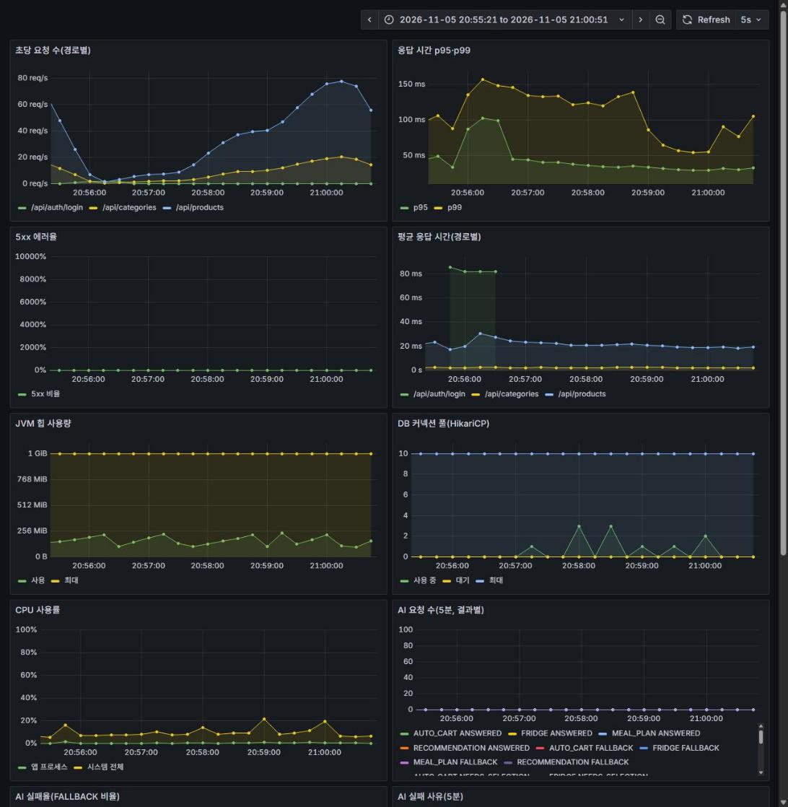

# 조회 캐시 (Redis)

인덱스 개선(`bottleneck.md`) 이후에도 남은 병목과 반복 조회를 줄이려고 Redis 캐시를 도입한 과정과 Before/After 결과를 기록한다.

## 1. 상황

- 인덱스 개선 후에도 키워드 검색의 개수(count) 쿼리(`LIKE '%키워드%'`)는 약 70~80ms로 남았다. 인덱스로 줄일 수 없는 쿼리이다(`bottleneck.md` 7절).
- 카테고리 목록, 영업 중 마트 목록처럼 모든 사용자가 같은 값을 반복해서 읽는 조회가 매번 DB를 거친다.
- 기존에는 캐시가 없었다. Redis는 로그인 제한·토큰 저장에 이미 쓰고 있다.

## 2. 후보와 선택

| 후보 | 장점 | 단점 |
| --- | --- | --- |
| **Redis (선택)** | 이미 쓰는 인프라(의존성, 로컬 Docker, 서버 연결). 서버가 여러 대여도 하나의 캐시를 공유해서 무효화가 모든 서버에 반영된다 | 조회마다 네트워크 왕복(약 1ms)이 든다. 응답이 `record`라 JSON 저장·복원 설정이 필요하다 |
| Caffeine(앱 안 메모리) | 설정이 간단하고 가장 빠르다 | 서버마다 캐시가 따로라서 서버가 늘면 무효화가 서로 어긋난다 |
| 캐시 없이 쿼리만 개선 | 구조가 단순하다 | 개수 쿼리처럼 인덱스로 못 줄이는 비용이 남는다 |

선택 이유: Redis는 새 인프라가 필요 없고, 서버가 늘어도 캐시 일관성이 유지된다. 왕복 1ms는 쿼리 70~100ms에 비해 무시할 수준이다. 응답 타입이 `record`라서 캐시 이름마다 타입을 지정한 JSON 직렬화를 쓴다(기본 설정은 복원 때 타입 오류가 난다).

## 3. 캐시 대상

| 대상 | 캐시 이름 | TTL | 무효화 |
| --- | --- | --- | --- |
| 카테고리 목록 | `categories` | 10분 | 카테고리 생성·수정·삭제 시 전체 삭제 |
| 영업 중 마트 목록 | `openMarts` | 5분 | 마트 생성·수정 시 전체 삭제 |
| 상품 검색 결과 | `productSearch` | 30초 | TTL 만료만 사용 |
| 레시피 검색어 자동완성 | `recipeSuggestions` | 30초 | TTL 만료만 사용 (#498에서 추가, 이 문서의 부하 측정에는 포함되지 않음) |

- 상품 검색 키: `마트:키워드:카테고리:최소가:최대가:페이지:크기:정렬`(예: `recipick:cache:productSearch::1:2#양파:null:null:null:0:20:price: ASC`).
- 상품 상세는 제외했다. 재고가 주문마다 바뀌어 캐시 이득보다 오래된 값의 위험이 크다.
- 주문·장바구니는 캐시를 거치지 않는 `ProductService.findProducts`로 가격을 읽으므로 금액 계산에는 영향이 없다.

## 4. 구현

- `global/config/CacheConfig`: Spring Cache + `RedisCacheManager`. 캐시마다 TTL과 값 타입을 지정하고 키 접두어 `recipick:cache:`로 로그인 제한 등 다른 Redis 데이터와 섞이지 않게 한다. `recipick.cache.enabled=false`로 끌 수 있다(테스트 프로필은 끈 채로 돌린다).
- Redis 장애 시: `CacheErrorHandler`가 조회·저장·삭제 오류를 로그로만 남기고 DB 조회로 넘어간다.
- `enableStatistics()`로 적중(hit)·실패(miss) 지표(`cache_gets_total`)를 Prometheus에 노출한다.
- 상품 검색 키는 키워드를 `글자수#키워드`로 쓰고 키워드가 없으면 `-`로 써서, "키워드 없음"과 "null이라는 검색어"를 구분한다.
- 테스트: `CacheIntegrationTest`(적중, 무효화, 조건별 분리, 생성 결과 비캐시), `CacheErrorHandlerTest`(오류 무시).

## 5. 부하 테스트 결과

같은 시나리오(`scripts/perf/k6/product-search.js`), 같은 조건(앱, MySQL, Redis, Prometheus, Grafana를 켠 상태)에서 3회 측정하고 **중앙값**을 사용했다. 회마다 캐시를 비우고 시작했다.

| 항목 | 최초 Before | 인덱스 후 | 캐시 후 1회 | 캐시 후 2회 | 캐시 후 3회 | 캐시 후(중앙값) |
| --- | --- | --- | --- | --- | --- | --- |
| 처리량(요청/초) | 26.9 | 42.5 | 46.1 | 46.3 | 46.3 | **46.3** |
| 전체 평균 | 741ms | 103ms | 13.3ms | 13.7ms | 13.1ms | **13.3ms** |
| 전체 p95 | 2.66s | 264ms | 19.8ms | 20.3ms | 18.9ms | **19.8ms** |
| 전체 p99 | 3.71s | 363ms | 87.9ms | 83.2ms | 82.5ms | **83.2ms** |
| 실패율 | 0% | 0% | 0% | 0% | 0% | 0% |

API별 p95

| 요청 | 최초 Before | 인덱스 후 | 캐시 후(중앙값) |
| --- | --- | --- | --- |
| 키워드 검색 | 2.93s | 306ms | 19.5ms |
| 필터 검색 | 2.48s | 135ms | 21.2ms |
| 카테고리 조회 | 1.27s | 78ms | 4.2ms |

DB 커넥션 풀(HikariCP, 측정 구간 최대)

| 지표 | 최초 Before | 인덱스 후 | 캐시 후 |
| --- | --- | --- | --- |
| 사용 중 연결(active) | 10 (가득 참) | 10 | 5 |
| 연결을 기다린 요청(pending) | 69 | 23 | 0 |

캐시 적중률 (3회 합계, Prometheus `cache_gets_total`)

| 캐시 | 적중(hit) | 실패(miss) | 적중률 |
| --- | --- | --- | --- |
| 상품 검색 | 32,130 | 736 | 약 97.8% |
| 카테고리 | 8,313 | 4 | 약 99.9% |
| 영업 중 마트 | 0 | 0 | 시나리오에서 호출 없음 |

> 처리량이 크게 늘지 않은 것은 시나리오가 요청마다 1초씩 쉬기(think time) 때문이다. 응답 시간이 줄어도 가상 사용자 100명이 보내는 요청 수에는 한계가 있어, 개선 효과는 처리량보다 응답 시간(p95, p99)과 풀 대기 감소에서 잘 보인다.

### 5-1. 재측정 (2026-11-05, 최신 dev)

마지막 측정 뒤 백엔드가 바뀌어 같은 시나리오로 3단계를 다시 쟀다. 재측정 조건: dev `009a2a18`의 JAR(`-Xms256m -Xmx1024m`, 포트 28080/28081)을 `recipick_perf`(상품 100,661건, 회원 100명)에 연결해 실행했다. 호출 제한은 끄고 `product-search.js`를 호스트 k6로 3회씩 돌렸다. 단계마다 앱을 새로 띄웠고(Before는 인덱스 3개를 `DROP INDEX`로 제거한 뒤 시작, 인덱스 후는 앱 기동이 인덱스를 다시 만든 상태) 캐시는 Before·인덱스 후에 `recipick.cache.enabled=false`, 캐시 후에 켰다. 회마다 캐시 키를 비우고 시작했다. 기존 개발 앱(8080)과 다른 프로그램이 같은 PC에서 켜져 있었다.

> 10월 측정과 값이 다르다. Before는 더 빨라졌고(p95 2.66s → 1.87s) After는 더 느려졌다(인덱스 후 p95 264ms → 492ms, 캐시 후 19.8ms → 45.7ms). 그사이 백엔드 코드가 바뀌었고 `idx_product_mart_category_price_asc`가 이번 인덱스 후에는 포함되며, 실행 방식(JAR)과 PC 상태도 같다고 보장하지 않는다. 원인은 확정하지 않았다. 아래 표는 같은 날 같은 조건에서 3단계를 이어서 잰 값이라 단계 사이의 비교에는 쓸 수 있지만 10월 표와 직접 비교하지 않는다.

| 항목 | Before (인덱스 X·캐시 X) | 인덱스 후 (캐시 X) | 캐시 후 |
| --- | --- | --- | --- |
| 처리량(요청/초, 중앙값) | 27.1 | 39.6 | 45.7 |
| 전체 평균 | 734ms | 186ms | 23.5ms |
| 전체 p95 (3회) | 2015 / 1874 / 1823ms | 511 / 478 / 492ms | 46 / 44 / 51ms |
| 전체 p95(중앙값) | **1.87s** | **492ms** | **45.7ms** |
| 전체 p99(중앙값) | 2.18s | 603ms | 115ms |
| 키워드 검색 p95 | 2.02s | 548ms | 45.3ms |
| 필터 검색 p95 | 1.62s | 369ms | 49.6ms |
| 카테고리 조회 p95 | 955ms | 192ms | 13.1ms |
| 실패율 | 0% | 0% | 0% |
| 풀 대기(pending) 최대 | 62 | 23 | 0 |
| 사용 중 연결(active) 최대 | 10 | 10 | 4 |

캐시 적중률(캐시 단계 3회 합계, Prometheus `cache_gets_total`, 앱 기동 후 누적): 상품 검색 적중 21,319 / 실패 550(약 97.5%), 카테고리 적중 5,478 / 실패 2(약 99.9%). 영업 중 마트는 호출이 없었다.

Before·인덱스 후 캡처는 [상품 검색 병목 개선 5-1절](bottleneck.md)에 있다. 그래프 해석 주의는 같은 절을 따른다. 처리량 증가가 작은 것은 위 5절과 같이 요청 사이 1초 대기 때문이다.

## 6. 해석

- 커넥션 풀 대기(pending)가 인덱스 후 23에서 0으로, 사용 중 연결이 10(가득 참)에서 5로 줄었다. 반복되는 조회가 DB를 거치지 않으면서 풀 경쟁이 사라진 것이다.
- 인덱스로 줄이지 못한 키워드 검색의 개수 쿼리(약 70~80ms)도, 같은 검색이 캐시에서 나오면 실행되지 않는다.
- 캐시 적중 시 응답은 약 13~15ms이다. 남은 시간은 인증·필터·Redis 왕복·직렬화 비용이다.

## 7. 한계와 주의

- **적중률이 실제보다 높게 나온 결과이다.** k6 시나리오는 검색어가 5개, 필터 조합이 한정적이라 같은 요청이 계속 반복된다. 실제 사용자의 검색어는 훨씬 다양해서 상품 검색의 적중률은 이보다 낮고 개선 폭도 작을 것이다. 카테고리와 영업 중 마트 목록은 모든 사용자가 같은 값을 읽으므로 이 영향이 작다.
- **상품 검색 응답의 가격·품절 표시가 최대 30초 늦게 반영될 수 있다.** 주문 금액은 캐시를 거치지 않는다.
- 카테고리·마트 변경 시 캐시 삭제가 Redis 장애로 실패하면 오래된 값이 TTL(10분, 5분) 동안 남을 수 있다. 캐시 삭제는 DB 커밋보다 먼저 실행되므로, 그 사이에 들어온 조회가 옛 값을 다시 저장하는 경합이 이론상 가능하다(상한은 TTL이다: 마트 5분, 카테고리 10분). `transactionAware()`로 커밋 후 삭제를 하면 이 경합은 막을 수 있지만, 커밋 후 발생한 Redis 오류가 `CacheErrorHandler`를 거치지 않고 API 실패로 전파되어 Redis 장애 시 가용성이 깨지므로 채택하지 않았다. 읽기 캐시에서는 약간 오래된 값을 허용하고 가용성을 우선했다.
- 검색어마다 키가 생겨 Redis 메모리가 늘 수 있다. TTL 30초로 자동 정리되며, 키 개수와 메모리는 측정하지 않았다.
- Redis 장애 시 DB로 대체하는 동작은 오류 처리기를 단위 테스트로만 확인했다. 실제로 Redis를 끄고 API를 호출하는 확인은 하지 않았다.
- 영업 중 마트 캐시는 구현했지만 이번 부하 시나리오가 호출하지 않아 효과를 측정하지 못했다.
- 로컬 단일 PC 측정이라 절대값이 아니라 같은 조건의 Before/After 비교에 의미가 있다. 서버(AWS)가 확정되면 다시 측정한다.
- 서버를 여러 대로 늘려도 Redis 캐시는 공유되므로 별도 전환이 필요 없다. 다만 Redis 장애 시 모든 서버가 DB로 몰리므로 DB 여유를 확인해야 한다.
