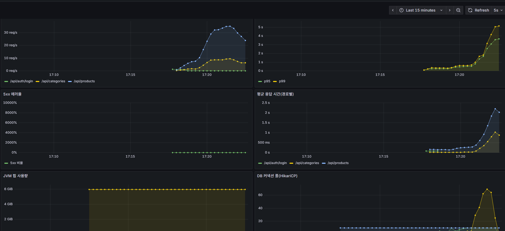
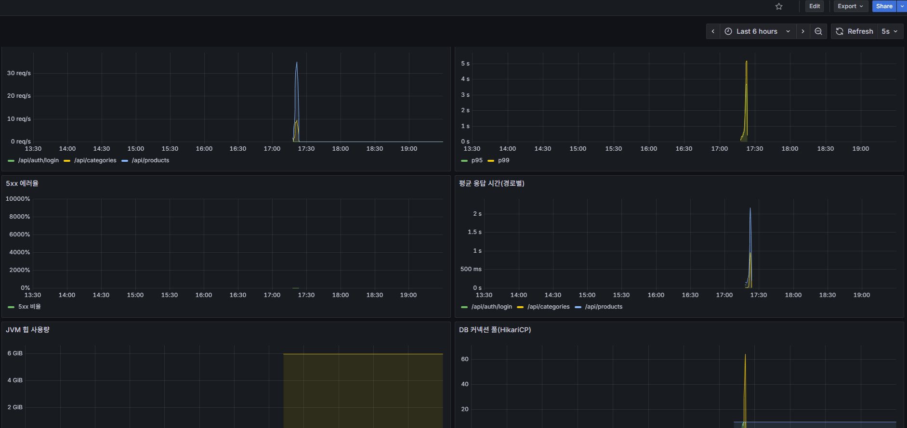

# 부하 테스트 (Before)

## 1. 상황

- 필수 8(부하 테스트)과 이후 병목 개선(필수 9)·캐싱(필수 10)은 모두 **같은 조건에서 잰 Before → After 수치**로 평가한다.
- 상품 검색(`GET /api/products`)은 회원 전용이고, 이름 포함 검색(`LIKE '%키워드%'`)과 카테고리·가격 필터, 정렬을 조합하는 가장 무거운 조회라서 부하 테스트의 중심으로 삼았다.
- 상품 검색은 로그인한 회원의 `mart_id`로 마트를 정하므로, 마트가 배정된 테스트 회원이 필요하다.

## 2. 후보와 선택

### 도구

| 후보 | 장점 | 단점 |
| --- | --- | --- |
| JMeter | 화면(GUI)으로 시나리오 작성, 사용 사례가 많음 | 시나리오가 XML이라 코드 리뷰·변경 이력 관리가 어렵고 무거움 |
| Gatling | 코드로 시나리오 작성, 리포트가 좋음 | Scala/Java DSL 학습 비용, 별도 빌드 구성이 필요 |
| **k6(선택)** | 시나리오가 JS 한 파일이라 짧고 리뷰하기 쉬움, 단계별 부하·API별 결과 분리·합격선 지정이 쉬움, Docker 이미지로 설치 없이 실행 | JS 런타임이라 JVM 라이브러리를 쓸 수 없음 |


- k6를 Docker 이미지(`grafana/k6`)로 실행한다. 팀원은 설치 없이 같은 명령으로 같은 시나리오를 재현할 수 있다.

### 로그인 방식

- 로그인(BCrypt)은 한 번에 수십~수백 ms가 걸린다. 요청마다 로그인하면 상품 검색이 아니라 로그인 성능을 재게 된다.
- 그래서 k6의 `setup()`에서 회원마다 한 번만 로그인하고, 이후에는 토큰(유효 30분)을 재사용한다.

### 테스트 회원

- `scripts/perf/seed-members.sql`로 성능 회원 100명(`perf-user-001~100@recipick.test`)을 한 번에 만든다. 같은 BCrypt 해시와 `mart_id=1`(삼청 마트)을 직접 넣는다.
- 가입 API를 100번 호출하는 것보다 빠르고 매번 같은 계정이 만들어진다. 재실행하면 기존 성능 회원은 지우지 않고 값만 갱신한다(회원 번호와 연결된 데이터가 유지된다).
- 비밀번호는 로컬 성능 테스트 전용 값이며 실서비스 값이 아니다.

## 3. 시나리오

스크립트: `scripts/perf/k6/product-search.js`

| 요청 | 비율 | 설명 |
| --- | --- | --- |
| 키워드 검색 | 50% | `keyword=`(대파·유기농·양파·두부·소고기 중 무작위), 20건 |
| 필터 검색 | 30% | 카테고리(1~20 무작위) + 가격 1,000~20,000원 + 가격 낮은 순 |
| 카테고리 조회 | 20% | `GET /api/categories`(가벼운 API 비교용, 공개 API) |

- 각 가상 사용자(VU)는 요청 후 1초 쉬고 반복한다(실제 사용자 흉내).
- 부하 단계: 10명 → 50명 → 100명, 각 단계마다 올리는 30초와 유지하는 1분, 마지막 20초 감소. 총 약 4분 50초.
- 데이터는 `docs/performance/product/seed-data.md`의 시드(마트당 상품 5만 건)를 쓴다.
- 합격선(threshold)은 `p95 < 1초`, 실패율 `< 1%`이다. 이 값은 합격 판정이 아니라 **Before/After 비교용 기준선**이며, 넘겨도 측정은 끝까지 진행되고 결과가 남는다.

## 4. 실행 방법

1. `docker compose up -d`로 MySQL·Redis를 띄운다(`.env`의 `MYSQL_DATABASE=recipick_perf`, 시드 데이터는 `seed-data.md` 참고).
2. 앱을 한 번 실행해 테이블을 만들고, 레포 루트에서 Git Bash로 테스트 회원을 만든다.
   ```bash
   docker exec -i recipick-mysql sh -c 'mysql -uroot -p"$MYSQL_ROOT_PASSWORD" --default-character-set=utf8mb4 recipick_perf' < scripts/perf/seed-members.sql
   ```
3. 앱을 `local` 프로필로 실행한다(앱 포트 8080, 관리 포트 8081).
4. `docker compose -f docker-compose.monitoring.yml up -d`로 모니터링을 실행한다. Before/After 모두 모니터링을 켠 상태에서 측정한다.
5. 부하를 실행한다(약 5분). Git Bash에서 실행하고, 맨 앞의 `MSYS_NO_PATHCONV=1`은 Git Bash가 `/scripts` 경로를 윈도우 경로로 바꾸지 않게 한다.
   ```bash
   MSYS_NO_PATHCONV=1 docker run --rm -i -v "$(pwd -W)/scripts/perf/k6:/scripts:ro" grafana/k6:1.3.0 run /scripts/product-search.js
   ```
   앱 포트가 다르면 `-e BASE_URL=http://host.docker.internal:포트`를 추가한다.

## 5. Before 결과 (2026-10-27, 로컬)

After와 같은 조건(앱, MySQL, Prometheus, Grafana를 모두 켠 상태)에서 잰 **2회차 측정**을 Before 기준값으로 쓴다. 모니터링 없이 잰 1회차는 참고용으로 아래에 함께 적는다.

| 항목 | 2회차 (Before 기준, 모니터링 켬) | 1회차 (참고, 모니터링 끔) |
| --- | --- | --- |
| 총 요청 수 | 8,069 (로그인 100건 포함) | 8,915 |
| 처리량 | 약 26.9 요청/초 | 약 29.8 요청/초 |
| 실패율 | 0% | 0% |
| 평균 응답 시간 | 741ms | 575ms |
| 중앙값 | 376ms | 373ms |
| p90 / p95 / p99 | 2.05s / 2.66s / 3.71s | 1.38s / 1.47s / - |
| 최대 | 6.27s | 2.66s |

API별 응답 시간 (2회차)

| 요청 | 평균 | 중앙값 | p95 | p99 | 기준(p95 1초) |
| --- | --- | --- | --- | --- | --- |
| 키워드 검색 | 985ms | 499ms | 2.93s | 3.88s | 초과 |
| 필터 검색 | 646ms | 150ms | 2.48s | 3.42s | 초과 |
| 카테고리 조회 | 319ms | 59ms | 1.27s | 2.03s | 초과 |

DB 커넥션 풀(HikariCP, Prometheus 기록, 측정 구간 최대값)

| 지표 | 값 |
| --- | --- |
| 풀 최대 크기(max) | 10 |
| 사용 중 연결(active) | 10 (풀이 가득 참) |
| 연결을 기다린 요청(pending) | 최대 69 |
| 연결 대기 타임아웃 | 0건 |




두 회차의 차이(p95 1.47s와 2.66s)가 크다. 같은 PC에서 돌리면 다른 프로그램과 모니터링 도구가 자원을 나눠 쓰기 때문이다. 그래서 After도 모니터링을 켠 같은 조건에서 재고, 가능하면 3회 측정해 중앙값을 쓴다.

### 재측정 (2026-11-05)

최신 dev로 Before(인덱스 X·캐시 X)를 다시 쟀다. 전체 p95 중앙값 1.87s(3회 2015 / 1874 / 1823ms), 평균 734ms, 처리량 27.1 요청/초, 실패율 0%, 풀 대기 최대 62다. 조건·인덱스 후·캐시 후 비교는 [병목 개선 5-1절](bottleneck.md)과 [캐시 5-1절](caching.md)에 있다. 위 10월 값은 당시 기준으로 그대로 둔다.

## 6. 해석

- 100명이 동시에 접속하는 구간에서 **커넥션 풀이 가득 찼다.** 풀은 10개인데 연결을 기다린 요청이 최대 69개까지 쌓였다. 에러는 없지만(타임아웃 0건) 요청이 줄을 서서 응답이 느려졌다고 볼 수 있다.
- 풀이 가득 찬 이유는 **쿼리 하나가 연결을 오래 쥐고 있기 때문**일 가능성이 크다. 이 경우 풀 크기만 키우면 DB 부담만 늘 수 있어서, 먼저 쿼리를 빠르게 만든다. 이것은 가설이며 **다음 병목 개선 단계에서 `EXPLAIN`으로 확인한다.**
- 가장 느린 것은 키워드 검색이다. 이름 포함 검색(`LIKE '%키워드%'`)은 앞부분이 고정되지 않아 일반 인덱스를 쓰기 어렵다는 가설을 세웠다.
- 필터 검색도 p95가 1초를 넘는다. 카테고리·가격 조건과 정렬을 지원하는 인덱스가 없는 것이 원인 후보이다(`PRODUCT`에는 `(mart_id, ingredient_id)` 인덱스만 있다).
- 카테고리 조회는 가벼운 API인데도 p95가 1.27s다. 상품 검색이 연결을 다 쓰고 있어서 같이 기다린 것으로 보인다. 상품 검색 쿼리가 빨라지면 함께 좋아지는지 After에서 확인한다.
- 이 단계의 개선 목표(After)는 키워드·필터 검색 p95를 줄이고 같은 부하에서 처리량을 높이며 pending을 줄이는 것이다. 목표 수치는 병목 원인을 확인한 뒤 정한다.

## 7. 한계

- **로컬 단일 PC 측정**이다. 앱, MySQL, k6와 개발 도구(IntelliJ, 슬랙, 브라우저)가 한 컴퓨터의 CPU와 메모리를 함께 쓴다. 2회차 카테고리 조회의 p95가 1.27s로 높은 것도 이 영향이 크다. 절대값이 아니라 **같은 조건에서의 Before/After 비교**에 의미가 있다.
- 서버(AWS)가 확정되면 같은 시나리오로 다시 측정한다.
- 측정이 2회뿐이고 값이 흔들렸다. After를 잴 때는 같은 환경(켜 둔 프로그램 포함)에서 3회 재서 중앙값을 쓴다.
- 1회차 총 요청 수는 8,915건이다. 이 중 `setup()` 로그인 100건을 제외한 8,815건이 시나리오 요청이다.
- 시나리오는 상품 검색 중심이다. 주문·장바구니·결제 등 쓰기 API 부하는 측정하지 않았다.
- 시드 데이터가 인위적이라(`seed-data.md` 한계 참고) 실제 검색어 분포와 다르다.


## 100명 종합 시나리오 준비

`scripts/perf/k6/shopper-journey.js`는 컬럼 변경 완료 전 준비한 추가 스크립트다. 이번 준비 작업에서 DB 시드 생성·부하 실행·운영 설정 변경은 수행하지 않았고 측정 결과도 없다. 기존 상품 검색 Before/After 스크립트와 결과는 그대로 유지한다.

- 최대 100 VU, 10 → 30 → 60 → 100명으로 증가하며 약 6분 20초 + 종료 유예. 각 흐름 뒤 1초 대기한다. VU 수는 요청/초가 아니다.
- `MODE=read`(기본): 상품 검색·상세·카테고리, 레시피 목록·상세, 내 정보·주문 목록·포인트 조회.
- `MODE=cart`: 회원별 장바구니 담기·수량 수정·조회·삭제.
- `MODE=purchase`: 장바구니 → 주문 미리보기 → 양수 결제 대기 주문 생성 → 결제 전 취소 → 주문 종료 확인 → 장바구니 삭제. 포인트 사용은 0이다.
- `MODE=mixed`: 흐름 횟수 기준 상품 50%·레시피 20%·내 정보 10%·장바구니 10%·주문 10%인 초기 측정 가정이다. 실제 사용자 비율을 측정한 값은 아니며 HTTP 요청 비율과도 다르다.
- 결제 성공·PG 환불·배송·포인트 적립·AI·관리자·가입/탈퇴 부하는 이번 스크립트에 포함하지 않는다. 로그인은 setup에서만 하므로 로그인 부하도 별도다.

### 컬럼 변경 병합 후 실행 준비

1. 별도 성능 DB에 최종 스키마와 상품·레시피·회원 데이터를 맞춘다. 계정은 기존 시드의 `perf-user-001~100@recipick.test` 규칙을 사용한다. 회원별 이용 마트가 필요하다.
2. `shopper-fixtures.example.json`을 `shopper-fixtures.local.json`으로 복사한다. 쓰기 모드는 같은 이용 마트에서 판매·재고가 유효한 `productIds`와 실제 서비스 지역의 배송 정보를 채운다. 상품 ID 공유 시 재고 경합이 생기므로 분산할지 의도적으로 공유할지 고정한다.
3. 회원별 장바구니·진행 중 주문을 비우고 측정 구간의 재고를 충분히 준비한다. 스크립트는 기존 항목을 일괄 삭제하지 않으며 준비 상태가 맞지 않으면 setup에서 중단한다.
4. 측정 대상 앱에 `RATE_LIMIT_ENABLED=false`를 적용하고 모니터링을 같은 조건으로 켠다. 비밀번호는 `PERF_PASSWORD` 환경 변수로만 전달한다.
5. 먼저 `SMOKE=1`로 1명·1회 실행한다. read는 모든 조회 흐름을, mixed는 조회·장바구니·주문 흐름을 각 한 번씩 확인한다. 이것은 데이터가 준비된 뒤 실행할 기능 점검이며 현재 완료된 결과가 아니다.

Mac에서 프로젝트 루트 기준 예시:

```bash
# PERF_PASSWORD는 터미널 환경에 성능 계정 비밀번호를 설정한다. 실제 서비스 계정은 사용하지 않는다.
docker run --rm -e PERF_PASSWORD -e MODE=mixed -e SMOKE=1 \
  -e BASE_URL=http://host.docker.internal:8080 \
  -e FIXTURE_FILE=/scripts/shopper-fixtures.local.json \
  -v "$PWD/scripts/perf/k6:/scripts:ro" \
  grafana/k6:1.3.0 run /scripts/shopper-journey.js
```

1명 점검 후 실제 100명 측정은 위 명령에서 `-e SMOKE=1`을 제거한다. 조회만 측정할 때는 `MODE=read`로 둔다. 운영 URL로 임의 전환하지 않으며 별도 성능 환경에서 데이터를 준비한 뒤 실행한다.

### 지표와 종료 확인

`http_req_duration{phase:journey}`·API별 고정 name 태그, `journey_duration`, `journey_failed`, `contract_failed`, `journey_completed`를 확인한다. setup 요청은 phase 태그로 분리한다. 로그인은 계정별 순서대로 하고 독립적인 GET은 계정 안에서 batch로 병렬 조회한다. 상품·레시피 상세는 목록 최대 100건을 회원·반복별로 나눠 조회한다(실제 데이터가 적으면 중복될 수 있다). p95 1초·실패율 1%는 기존 검색 기준을 가져온 비교선이며 모든 업무의 확정 SLO가 아니다.

`blocked_writers`·`cleanup_failed`·`skipped_writes`는 0이어야 한다. 주문 생성 응답 유실·서버 오류에는 1초 대기 뒤 같은 키와 같은 본문으로 한 번만 확인한다. 최초 요청이 명확한 4xx로 거절되면 장바구니를 정리한다(COMMON-006 처리 중은 제외). 최초 결과가 불명확하면 재시도가 4xx여도 정리하지 않는다. 주문·장바구니 담기 결과가 불명확하거나 정리가 실패하면 해당 VU의 추가 쓰기를 막고, mixed의 조회 흐름은 계속한다. 건너뛴 쓰기도 journey_failed·journey_duration과 skipped_writes에 기록하며 실제 HTTP 요청 수를 인위적으로 늘리지는 않는다. 성공한 흐름은 본인이 추가한 항목만 삭제한다. 불명확한 주문이 남으면 임의로 새 주문·환불을 만들지 않으며, 중단·강제 종료 후 잔여 주문·장바구니를 담당자가 확인해야 한다.

각 회차의 회원·상품·재고·캐시 조건을 동일하게 맞추고, 종료 뒤 주문 CANCELED·결제 FAILED/CANCELED_BEFORE_PAY, 재고 복원·예약 포인트/적립 예정 취소를 확인한다. 스크립트의 HTTP 상태 확인만으로 재고·포인트 전체 정합성이 입증되는 것은 아니다. API 응답 계약이나 신규 필수 입력이 바뀌면 실제 실행 전에 요청부를 대조한다.


### 실패 요청 진단과 지표 시계열

`shopper-journey.js`의 HTTP 계약이 실패하면 `request_failure` JSON을 남긴다. 기록 항목은 고정 API 이름·phase·VU/반복·시작/종료 UTC 시각·전체 대기 ms·k6 오류 코드·연결 단계 timings·클라이언트 요청 ID·응답에 있을 때 서버 `X-Request-Id`다. URL/쿼리/요청·응답 본문/쿠키/인증 정보는 기록하지 않는다. `request_wall_time{phase:journey}`는 연결 전 대기를 포함한 실제 호출 대기 시간이며 HTTP 처리 구간 지표와 함께 본다. setup batch의 wall time은 배치 전체 완료까지의 시간이므로 개별 요청 지연으로 해석하지 않는다.

실패 응답을 받지 못해도 서버 기록과 연결하려면 **비운영 성능 앱에서만** Tomcat access log를 켠다. 서버 공통 보안 필터를 바꾸지 않고 k6가 보내는 `X-Perf-Request-Id`를 access log에 기록한다. JVM 설정 예:

```text
--server.tomcat.mbeanregistry.enabled=true
--server.tomcat.accesslog.enabled=true
--server.tomcat.accesslog.directory=/절대경로/성능결과/access
--server.tomcat.accesslog.pattern=%t %{X-Perf-Request-Id}i %m %s %D
```

패턴에는 URL·검색어·토큰·쿠키를 넣지 않는다. access log도 응답 완료 후에 남으므로, 기록이 없는 경우 TCP 연결이나 Tomcat 처리 전 대기 중 어디서 지연됐는지 단정하지 않는다. `tomcat_threads_*` 같은 지표는 MBean registry가 켜져 있어야 보일 수 있다. 없는 지표를 0으로 해석하지 않는다.

k6 실행 직전 별도 터미널에서 다음 수집기를 시작하고 실행이 끝나면 Ctrl+C로 종료한다. 관리 포트를 외부에 공개하지 않는다.

```bash
python3 scripts/perf/collect-metrics.py \
  --url http://localhost:28081/actuator/prometheus \
  --output scripts/perf/results/회차명/metrics --interval 5
```

CPU·GC·메모리·DB 풀·Tomcat·HTTP 지표만 수집하며 샘플 시작/종료 시각과 수집 실패도 `samples.jsonl`에 남긴다. 기본 5초 스냅샷은 순간 지연을 놓칠 수 있고 한 PC에서 지표 수집도 자원을 사용한다. 전후 요청 수·재고·주문·포인트 검사와 함께 보며, 이전 기록 없는 측정과 완전히 동일한 조건이라고 표현하지 않는다. 기존 결과를 덮어쓰지 않도록 매 회차 빈 폴더를 사용한다. 실패가 재현되면 동일 시간대와 요청 ID를 대조하고, 재현되지 않으면 원인 미확정 상태를 유지한다.


### macOS에서 Docker 경로와 호스트 실행을 구분하는 점검

로컬 Docker→호스트 경로에서만 새 연결 타임아웃이 반복되면, 앱 코드를 바꾸거나 연결 재사용을 끄기 전에 같은 k6 버전의 호스트 실행과 비교한다. 호스트 k6는 `host.docker.internal` 대신 `localhost`를 사용한다. 다음은 호스트 k6가 설치돼 있고 성능 전용 서버·DB·fixture·PERF_PASSWORD 준비가 끝난 경우의 예시다.

```bash
k6 run -e MODE=mixed -e SMOKE=1 \
  -e BASE_URL=http://localhost:28080 \
  -e FIXTURE_FILE="$PWD/scripts/perf/k6/shopper-fixtures.local.json" \
  scripts/perf/k6/shopper-journey.js
```

1명 점검 후 최대 100명 실행은 `-e SMOKE=1`만 제거한다. 기동 중인 개발 서버와 분리된 성능 서버 주소인지 먼저 확인한다. Docker/호스트 실행은 OS·네트워크 경로·자원 사용이 달라 각 회차의 실행 방법을 기록하고 서로를 성능 개선 Before/After로 취급하지 않는다. 짧은 비교에서 오류가 사라져도 특정 Docker 구성 요소의 결함까지 확정한 것은 아니다. 계측 변경 후 스크립트 회귀는 `python3 -m unittest discover -s scripts/perf/tests -v`와 k6 1명 점검으로 확인한다.


2026-11-03 실행 결과는 [로컬 100명 보고서](../local-100-users.md)와 [Docker 경유 타임아웃 분석](../../troubleshooting/k6-docker-host-timeout.md)에 기록했다. 기존 상품 검색 Before/After 결과와 이번 혼합 예비 검증을 구분한다.


### 로컬 성능 서버를 Grafana로 보기

성능 서버가 API 28080·관리 28081 포트로 실행 중일 때 저장소 루트에서 실행한다.

```bash
docker compose -f docker-compose.monitoring.yml -f docker-compose.monitoring.perf.yml up -d
```

- Grafana: http://localhost:3000 → 로그인 → Dashboards → Recipick → Recipick 개요.
- 최초 계정은 `admin`, 비밀번호는 실행 시 `GRAFANA_ADMIN_PASSWORD` 값이며 미지정이면 로컬 기본값 `admin`이다. 기존 볼륨이 있으면 기존 비밀번호가 유지된다.
- Prometheus: http://localhost:9090/targets 에서 `recipick` 대상 `host.docker.internal:28081`이 UP인지 확인한다.
- 대시보드 시간 범위를 최근 15분, 자동 새로고침을 5초로 두면 요청량·응답 시간·CPU·DB 연결을 함께 볼 수 있다. 요청 비율과 백분위 그래프에는 수집 샘플과 실제 요청이 필요하다.

모니터링 포트는 로컬 접속만 허용한다. 선택용 설정은 기본 개발 대상(8081)을 성능 대상(28081)으로 교체하므로 두 서버 지표를 합산하지 않는다. 기본 개발 대상으로 복귀하려면 `docker compose -f docker-compose.monitoring.yml up -d`를 실행한다. 볼륨은 삭제하지 않는다.

이 구성은 실행 이후의 지표를 저장한다. 이전에 파일로 수집한 부하테스트 결과가 자동으로 복원되지는 않는다. 이후 부하 실행은 호스트 k6로 진행하고 Grafana는 서버 측 지표로 해석한다. Docker 수집 경로의 장애는 Prometheus 대상 상태와 함께 확인하며 클라이언트 실패를 서버 그래프만으로 판단하지 않는다.
